# Subscription Revenue Analytics

**Stack:** n8n Cloud, Google BigQuery, Looker Studio, Loop Subscriptions API, CheckoutChamp API, Shopify (GraphQL and ShopifyQL), Meta Ads, Frankfurter FX API, Amazon Selling Partner API, Amazon Ads API, Python

A direct to consumer health and wellness brand sells subscriptions across 6 online stores on two platforms: **Loop** (Shopify based subscriptions) and **CheckoutChamp** (its own checkout and subscription platform), in the US, UK, EU, Australia and Canada. There was no single view of the business. Basic questions had no answer:

- What is our true combined MRR?
- How many active subscribers do we really have across all stores?
- What is churn, and where do subscribers drop off?
- How does ad spend turn into subscribers and revenue?
- What is a subscriber worth compared with a one time buyer?

I built daily n8n pipelines and Python jobs for Amazon into BigQuery, a raw, staging and mart model with 14 marts, and an 11 page Looker Studio report.

> Store names, domains, account IDs and credentials are removed. Stores appear as `store_1` to `store_6`. The workflows are the real ones, rebuilt with placeholders.
>
> The SQL in [`queries/`](queries/) is the real production SQL with the project ID replaced by `your-project` and store domains replaced by placeholders. The brand name is removed from every dashboard page and Amazon campaign names are blurred.

## How it works

```
Loop API (6 stores)   CheckoutChamp API   Shopify (6 stores)   Meta Ads   Frankfurter FX
        |                    |                   |                |            |
        +--------------------+------ n8n Cloud, every night -------+------------+
                                          |
Amazon SP-API, Amazon Ads API ---- Python jobs, daily ----+
                                          |
                                   Google BigQuery
                          raw.*      one table per source, ingested_at on every row
                          staging.*  deduplication, normalisation, status mapping
                          marts.*    14 reporting marts
                                          |
                                  Looker Studio (11 pages)
```

## n8n workflows

All in [`n8n/`](n8n/) (import the JSON to see every node), with a screenshot of each.

| Workflow | Schedule (NY) | What it does |
|---|---|---|
| [`loop_subscription_snapshot.json`](n8n/loop_subscription_snapshot.json) | 00:00 to 00:20 | Pulls every subscription from each Loop store (250 per page, until `hasNextPage` is false, 2 seconds between pages, 5 retries). Flattens billing, customer, shipping and line items into about 37 columns. One copy runs per pair of stores, staggered 10 minutes apart to stay inside API limits |
| [`exchange_rates.json`](n8n/exchange_rates.json) | 00:30 | Daily FX rates from Frankfurter, inverted to "currency to USD" so every amount can be converted |
| [`checkoutchamp_daily.json`](n8n/checkoutchamp_daily.json) | 02:00 | Order and transaction summaries, then purchases, orders and transactions. Each paged endpoint fetches page 1, reads the total, generates every page number and fetches them one at a time. Also loads the next 30 days of projected billing per campaign |
| [`shopify_sessions_daily.json`](n8n/shopify_sessions_daily.json) | 03:00 | ShopifyQL through the GraphQL Admin API for each store: sessions, add to cart, checkout reached, checkout completed and conversion rate, once by country and UTM and once by landing page |
| [`shopify_orders_daily.json`](n8n/shopify_orders_daily.json) | 10:00 | Shopify order lines (sales, refunds, discounts, UTMs, first visit source, post purchase survey answers) from a SyncWith sheet into BigQuery |
| [`meta_ads_daily.json`](n8n/meta_ads_daily.json) | 10:00 | Meta spend, reach, clicks and landing page views from a SyncWith sheet, with CTR, CPC, CPM and click to landing page drop off calculated on the way in |

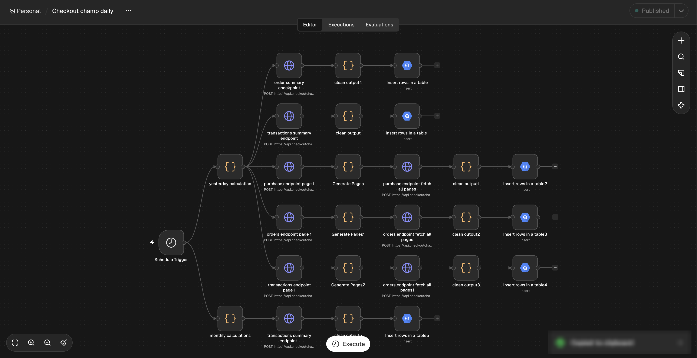

More screenshots: [Loop snapshot](n8n/n8n_loop_subscription_snapshot.png), [exchange rates](n8n/n8n_exchange_rates.png), [Shopify orders](n8n/n8n_shopify_orders_daily.png), [Meta ads](n8n/n8n_meta_ads_daily.png).

## Amazon jobs (Python)

All in [`python/`](python/). Credentials come from environment variables; none are in the code.

| Script | What it does |
|---|---|
| [`amazon_sales_traffic_daily.py`](python/amazon_sales_traffic_daily.py) | Requests the Selling Partner API Sales and Traffic report for yesterday, polls until it is done, downloads and unzips it, and loads ordered sales, units, refunds, shipped sales, page views, sessions and Buy Box % into `raw.daily_amazon_traffic` |
| [`amazon_sessions_daily.py`](python/amazon_sessions_daily.py) | The same report for two days ago, because Amazon sessions are only final after about 48 hours. Adds browser and mobile app sessions and page views. The staging view keeps the newest load per date, so this later, complete row replaces the early one |
| [`amazon_ads_download_insert.py`](python/amazon_ads_download_insert.py) | Amazon Ads reports are asynchronous, so a report request and a status check run earlier and write to a queue table (`raw.amazon_ads_report_queue`). This job skips the day if it is already loaded, takes the latest READY report from the queue, fetches a fresh download link if the old one has expired, loads campaign spend, clicks, purchases and sales at 1, 7 and 14 day attribution into `raw.daily_amazon_ads`, then marks the report DONE |

## BigQuery model

All SQL is in [`queries/`](queries/): 11 staging views, 14 mart views and the schema of the 22 raw tables the views and jobs use ([`raw_tables.sql`](queries/raw_tables.sql)).

**Raw:** one table per source (`daily_loop_subscriptions`, `daily_cc_purchases`, `historical_cc_purchases`, `daily_cc_orders`, `daily_cc_transactions`, `daily_exchange_rates`, `daily_shopify_sessions`, `daily_shopify_orders`, `daily_meta` and others). Every row carries `ingested_at`, so any number can be traced to the load it came from.

**Staging:** deduplication and status mapping.
- Loop: one row per subscription, latest load wins (`ORDER BY ingested_at DESC, updated_at DESC`).
- CheckoutChamp: daily records win over the historical backfill on ties (`ORDER BY date_updated DESC, data_source ASC, actual_purchase_id DESC`).

**Marts (14):**

| Mart | What it answers |
|---|---|
| `mart_subscriptions_daily` | Daily MRR, active, new, churned and paused subscribers, churn rate, by platform and country |
| `mart_cohort_retention` | Monthly cohort retention M0 to M12 |
| `mart_subscriber_level` | One row per subscriber with full lifecycle |
| `mart_ltv`, `mart_subscriber_ltv` | LTV at D30, D60, D90, D120, and subscriber vs non subscriber |
| `mart_funnel_daily`, `mart_funnel_stages` | Meta impressions to sessions, add to cart, checkout and orders |
| `mart_customer_acquisition` | New vs returning customers, new customer acquisition cost by country |
| `mart_unit_economics` | Monthly LTV:CAC and payback period |
| `mart_cc_payment_health` | First attempt payment success, dunning recovery |
| `mart_product_daily`, `mart_utm_daily` | Product and UTM attribution |
| `mart_amazon_ads`, `mart_amazon_traffic` | Amazon ads and marketplace traffic |

## Dashboard

11 pages in Looker Studio, every one filtered by date, and most by country, store and platform (Loop, CheckoutChamp or combined).

| Page | What it shows |
|---|---|
| Overview | The full path in one place: Meta ad exposure, clicks and landing, on site engagement, revenue (gross, net, refunds, discounts, taxes) and purchases (orders, CVR, AOV, CPA, ROAS) |
| Funnel | Each step as its own funnel: impressions to clicks, clicks to sessions, sessions to add to cart, add to cart to checkout, checkout to purchase |
| Customer Acquisition | New vs returning customers, orders and revenue, new customer rate and nCAC over time |
| Geographic Breakdown | Revenue, orders, spend, ROAS, CPA, CVR and add to cart rate for every country |
| Subscriptions | Combined MRR including payment recovery, take rate, forecast 30 day orders and revenue, first attempt payment success and dunning recovery |
| Subscriber Analytics | Active, new, paused and churned subscribers, churn rate and zero day churn |
| Cohort Retention | Monthly cohorts M0 to M11, by revenue and by subscribers |
| LTV Analysis | LTV at D30, D60, D90, D120 and overall, by cohort, and subscriber vs one time buyer |
| Amazon Traffic and Orders | Sessions, units, ordered and shipped sales, Buy Box %, unit session %, refund rate |
| Amazon Ads | Spend, sales, ROAS and ACOS per campaign |
| Unit Economics | Monthly nCAC, LTV:CAC at each window and CAC payback in months |


| | |
|---|---|
| 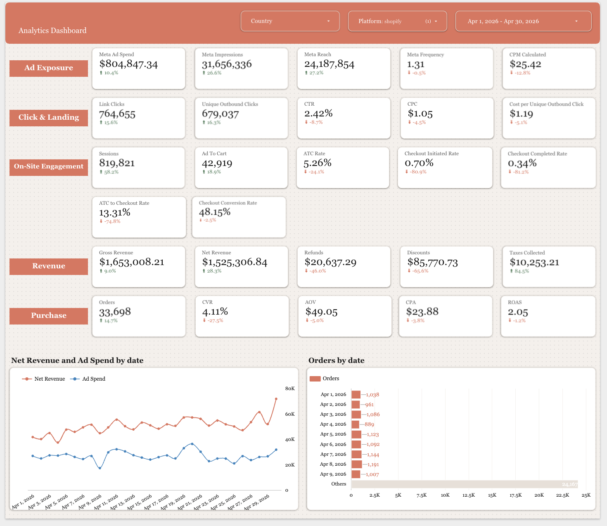 | 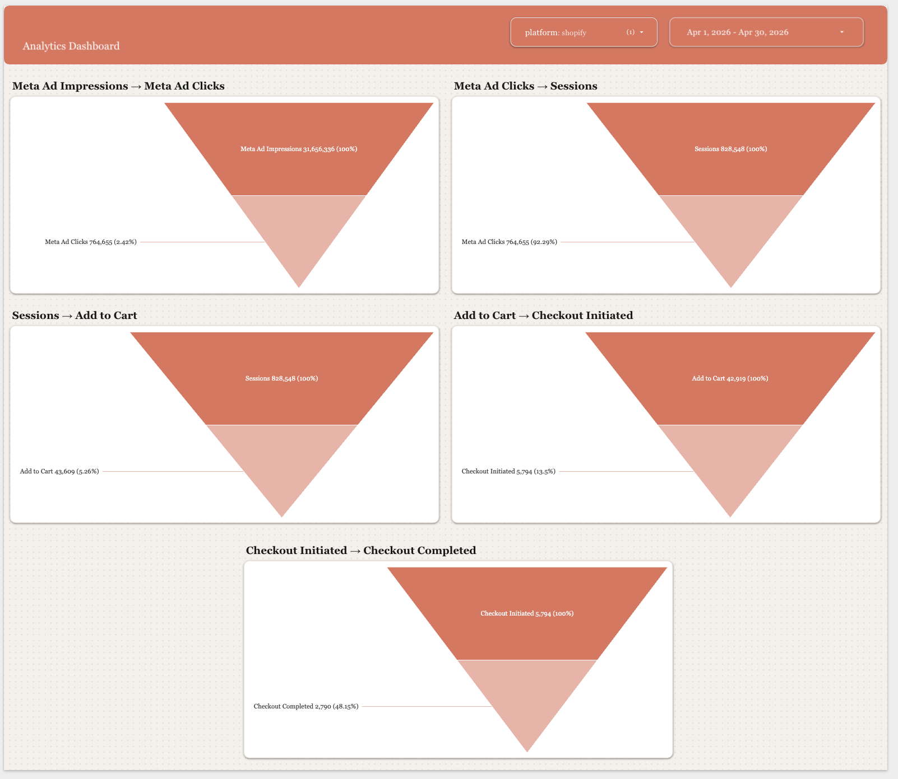 |
| 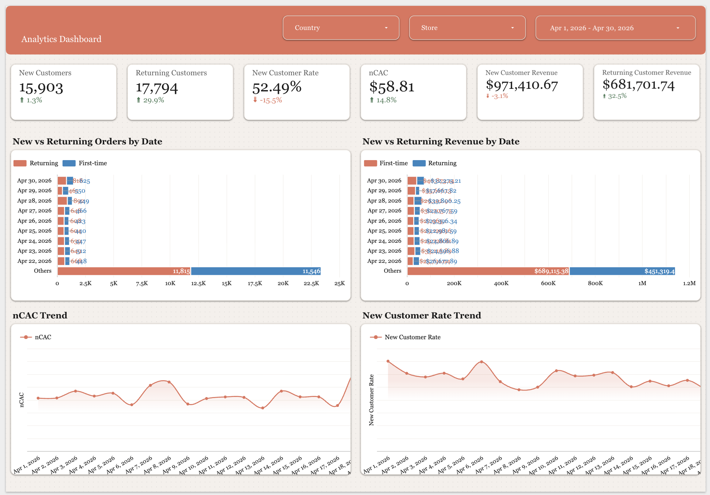 | 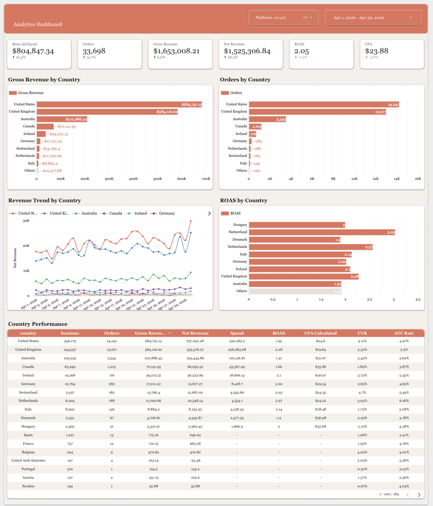 |
| 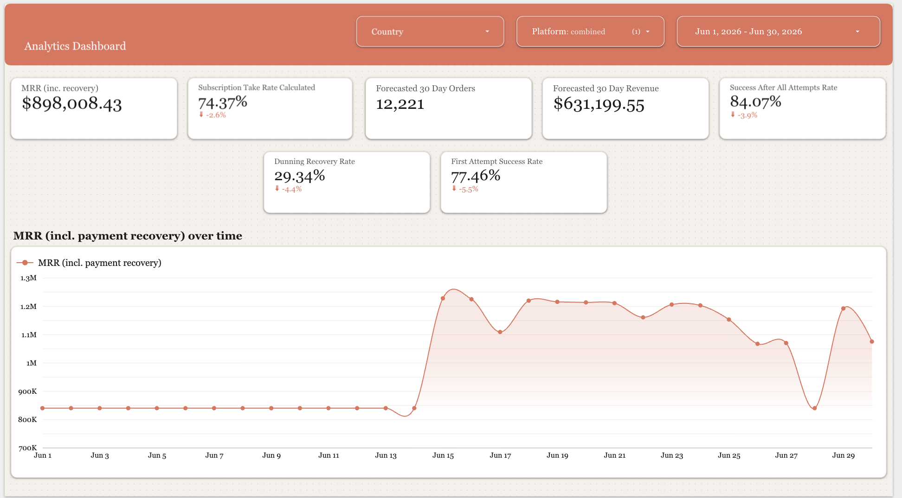 | 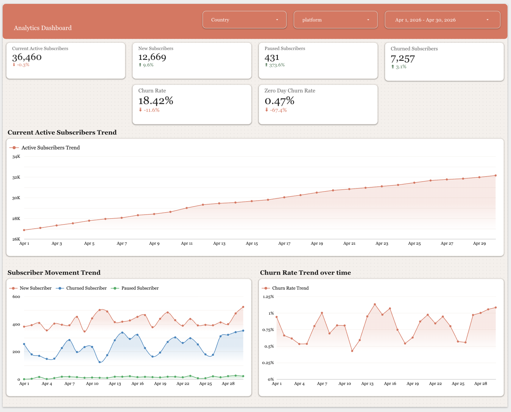 |
| 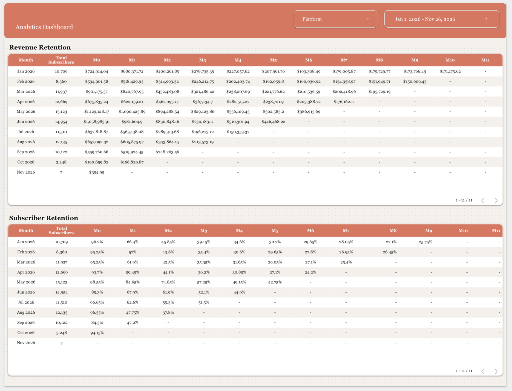 | 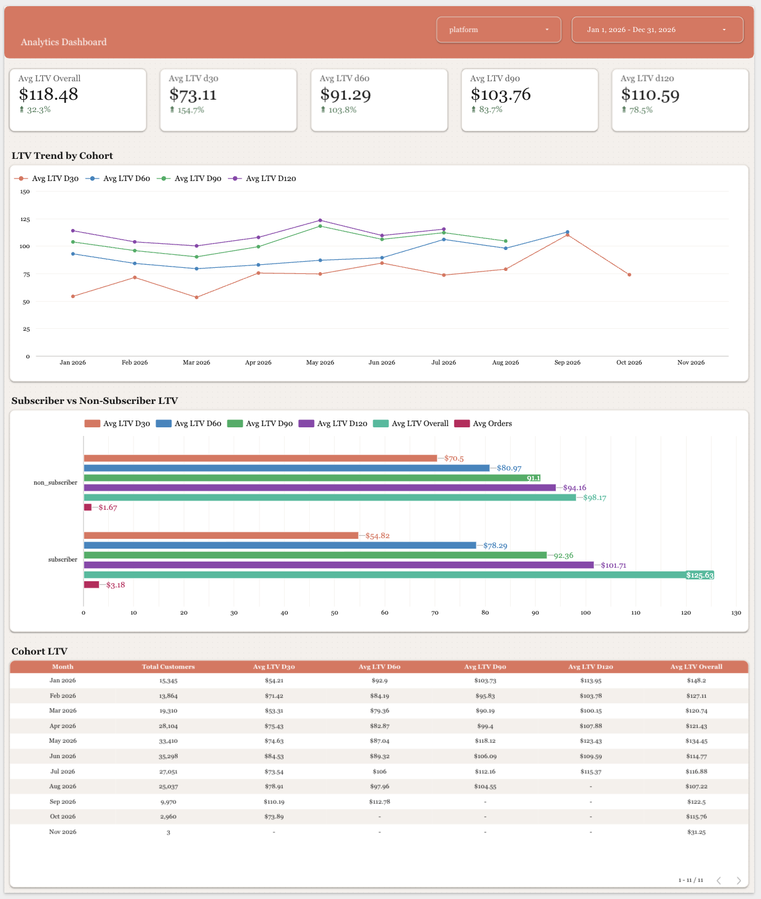 |
| 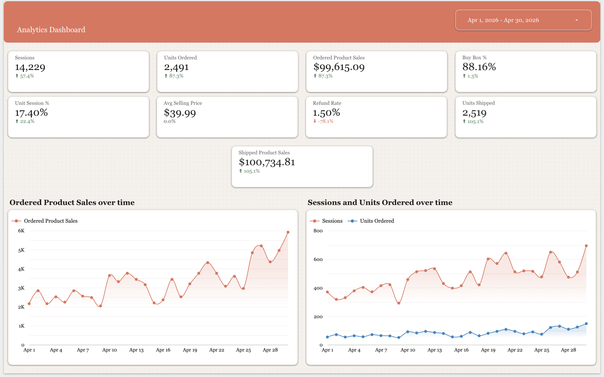 | 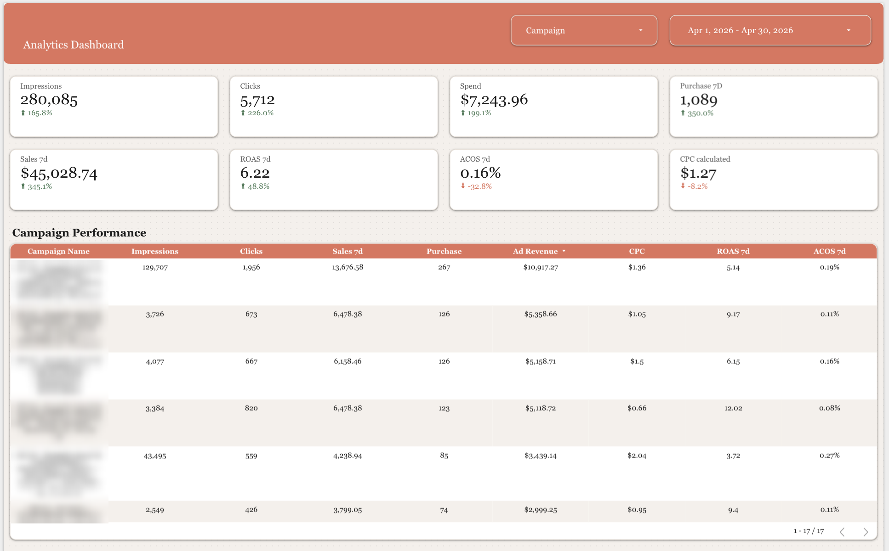 |
| 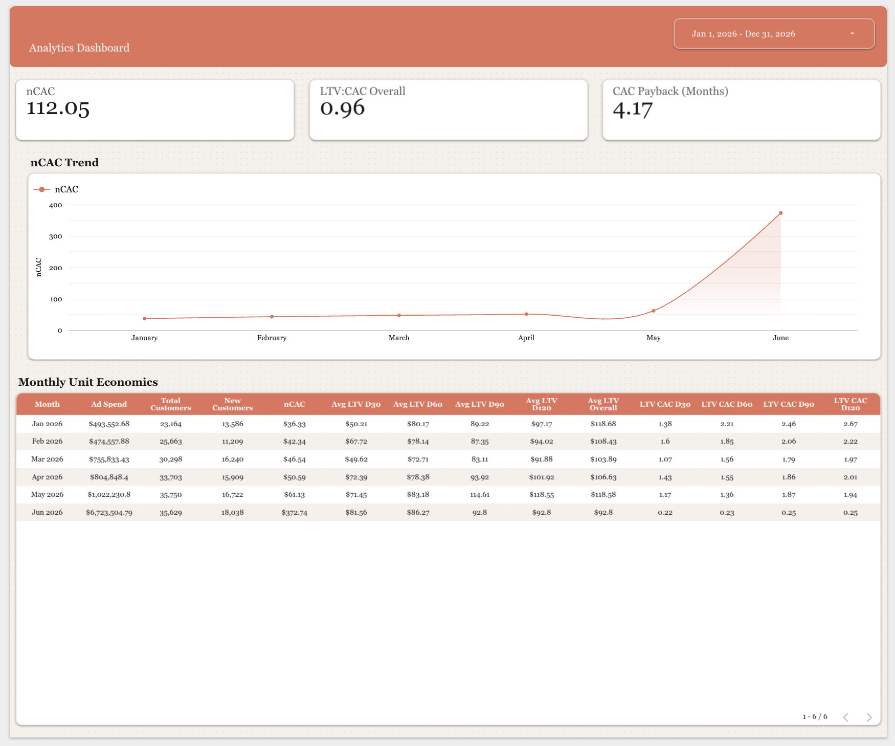 | |

## Problems found and fixed

1. **CheckoutChamp MRR understated by 97% ($34K instead of about $1M).** The pull only returned subscriptions updated that day, so 31,000 stable active subscriptions were missing. The MRR mart now cross joins every active subscription against a full date spine, so each one is counted every day whether it changed or not.
2. **The dashboard showed different numbers on every refresh.** 5,666 subscription IDs existed in both the historical and daily tables with the same `date_updated`, and BigQuery picked one at random. A deterministic tiebreaker (daily over historical, then ID) made it stable.
3. **Loop MRR in mixed currencies.** Stores bill in GBP, EUR, AUD and CAD, but every price was summed as USD (a £24 subscription counted as $24). The daily FX flow and a join on date and currency put everything in USD: Loop MRR went from $716K (wrong) to $373K (true USD).
4. **Active subscribers inflated by 1,554.** A running "new minus churned" total never subtracted paused subscriptions. Active is now read directly from the daily snapshot status, and matches the Loop API exactly.
5. **4x MRR inflation in staging.** Deduplication partitioned by subscription and load date, keeping one row per subscription per day instead of one overall. Fixed to one row per subscription.
6. **A redeploy broke the CheckoutChamp connection.** The API whitelists IPs, and a hosting redeploy changed the IP. Fixed and documented as an ongoing risk.
7. **Gaps from failed runs.** Flows were re-run after fixing the cause. Because the marts always take the newest `ingested_at`, re-running a partial day is safe.

## Results

| Metric | Before | After |
|---|---|---|
| CheckoutChamp MRR | $34K (97% of subscriptions missing) | $981K (all active) |
| Loop MRR | $716K (mixed currencies) | $373K (true USD) |
| Combined MRR | about $750K (wrong) | about $1.355M (verified) |
| Loop active subscribers | 12,705 (inflated) | 11,151 (matches the Loop API) |
| Dashboard stability | changed on every refresh | stable |
| Data freshness | manual | automated by 2 AM New York |
| Stores connected | 0 | 6 on 2 platforms |

**Verification against the source platforms:** store level active subscribers within 0.4% of the Loop dashboard and MRR within 1.1% (timing between snapshot and live), CheckoutChamp MRR within 0.9% of its export.
