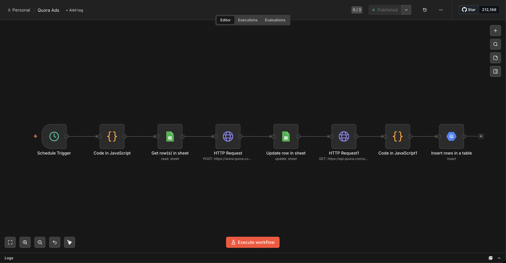
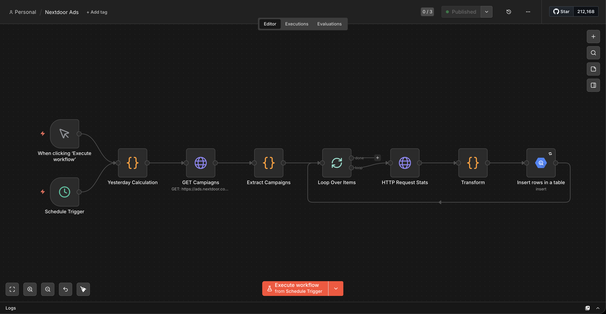
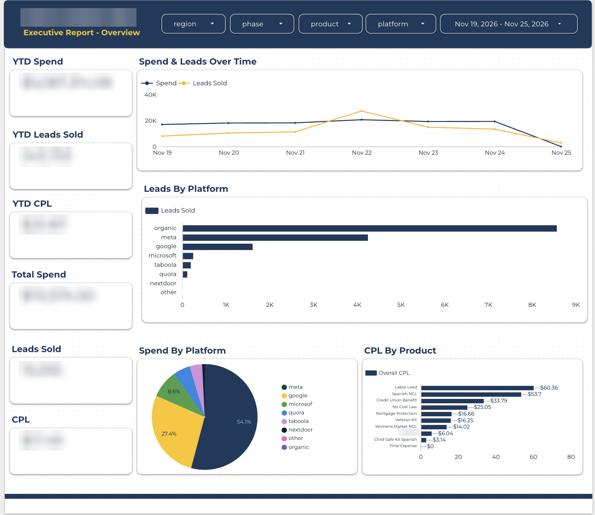
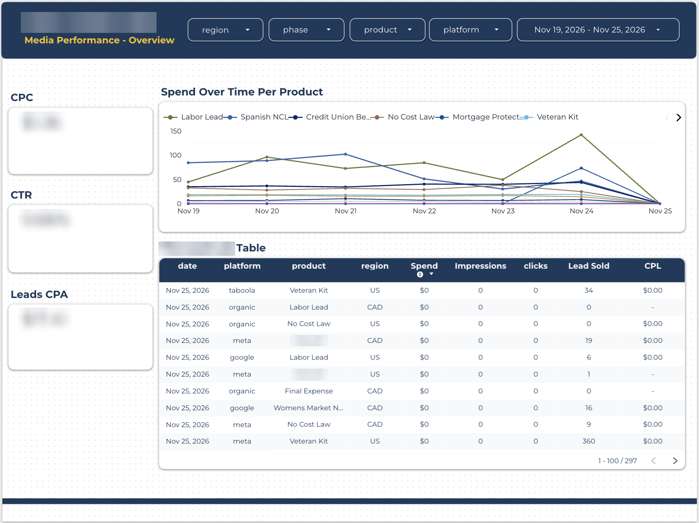
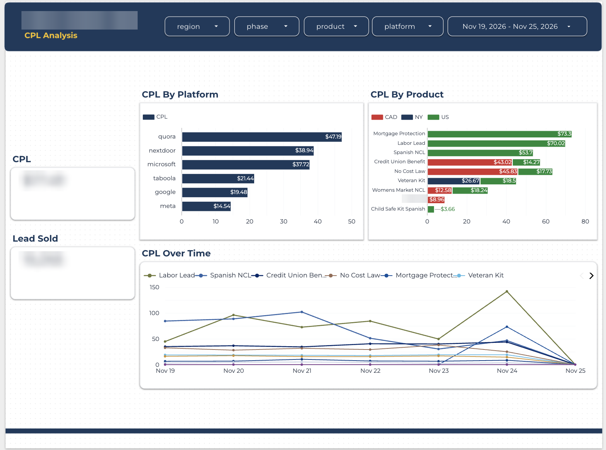
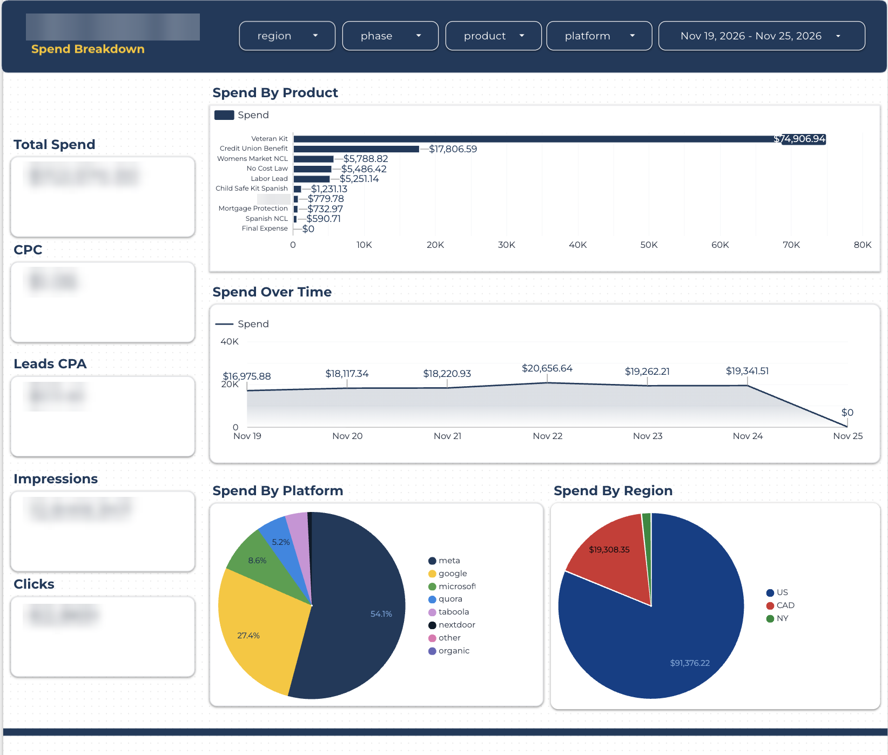
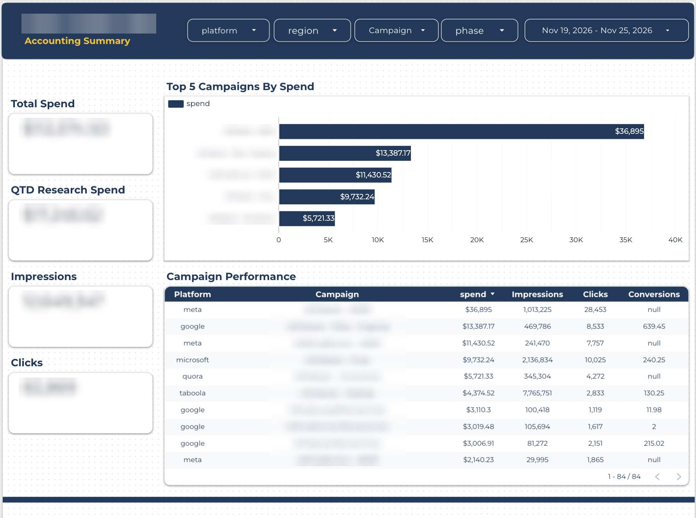
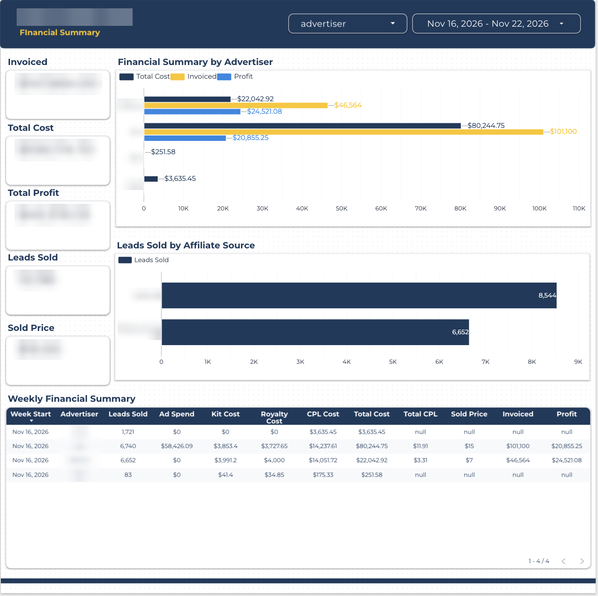
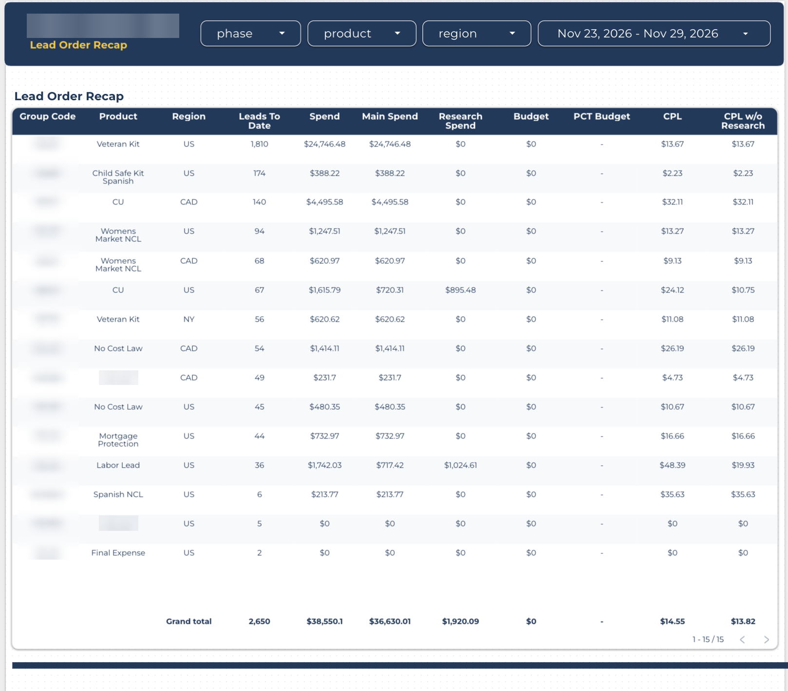
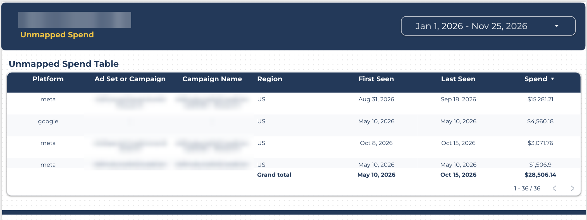

# Lead Generation Reporting System

**Stack:** BigQuery, Looker Studio, Windsor.ai, n8n (self hosted on Railway), Google Sheets, Leadspedia webhooks

A US lead generation company runs paid ads on 7 platforms, generates leads for about 10 products (veteran services, legal services, credit union benefits, child safety kits and others) and sells those leads to insurance advertisers in the US, Canada and New York. Volume is 2,000 to 5,000 sold leads a day, with more than $5M in yearly ad spend.

Before this, someone exported leads and spend every week and rebuilt cost per lead in Excel by hand. It took hours, broke often and had no history or audit trail. I built a pipeline that loads spend and leads into BigQuery automatically, holds every business rule in SQL views, and feeds a 13 page Looker Studio report that the team checks through the day.

> Client name, advertiser and partner names, campaign names, account IDs and headline numbers are removed or blurred. Advertisers appear as "Advertiser A" to "Advertiser E" and the main reseller partner as "Partner B". The SQL and workflows are the real ones, with names replaced.

## How it works

```
Ad spend                                     Leads
Meta, Google, Microsoft, TikTok, Taboola     Leadspedia (lead platform)
  -> Windsor.ai, daily                         -> webhooks, real time (lead sold, lead returned)
Quora, Nextdoor                                -> n8n -> BigQuery
  -> custom n8n API flows, daily
        |                                            |
        +------------> BigQuery <--------------------+
                          |
     Google Sheets connected as live tables:
     campaign mapping, budgets, kit and royalty rates
                          |
     staging views: one spend schema, product / region / advertiser mapping,
     deduplication, returns, research vs main spend
                          |
     reporting views: performance, CPL, financial model, daily and weekly reports
                          |
                 Looker Studio (13 pages)
```

## n8n workflows

All in [`n8n/`](n8n/) (JSON you can import, plus a screenshot of each).

| Workflow | What it does |
|---|---|
| [`quora_ads.json`](n8n/quora_ads.json) | Daily Quora campaign spend. Handles the OAuth refresh: the refresh token is stored in a sheet, read, exchanged for an access token, and the new refresh token written back, so token rotation never needs a redeploy |
| [`nextdoor_ads.json`](n8n/nextdoor_ads.json) | Daily Nextdoor spend. No connector exists, so it lists campaigns, then loops through them one at a time for stats |
| [`leadspedia_webhooks.json`](n8n/leadspedia_webhooks.json) | Real time lead sold and lead returned events, about 40 fields each (advertiser, contract, campaign, vertical, affiliate, state, UTMs), straight into BigQuery |
| [`campaign_sync.json`](n8n/campaign_sync.json) | Finds campaigns that started spending in the last 30 days and adds any new ones to the mapping sheet, or updates renamed ones |
| [`adset_sync.json`](n8n/adset_sync.json) | Same for Meta ad sets, where the product is set at ad set level |
| [`daily_spend_check.json`](n8n/daily_spend_check.json) | Every morning, checks whether each platform's spend landed for yesterday. Only alerts if a platform that normally spends shows nothing, so quiet platforms do not cause false alarms |
| [`error_notifications.json`](n8n/error_notifications.json) | Set as the error workflow on every flow. Any failure sends an email with the workflow, the failed step, the error and a link to the run |




More screenshots: [campaign sync](n8n/n8n_campaign_sync.png), [ad set sync](n8n/n8n_adset_sync.png), [daily spend check](n8n/n8n_daily_spend_check.png), [error alerts](n8n/n8n_error_notifications.png), [webhooks](n8n/n8n_leadspedia_webhooks.png).

**Why n8n on Railway instead of Make:** the lead accepted event alone fired over 500 times in 12 hours. At two operations per event that projected to about 60,000 operations a month for one event type, against a 10,000 limit. Self hosted n8n costs about $20 a month with no per operation limit, and has run for months.

## BigQuery

All 21 views are in [`queries/`](queries/), named `dataset__view.sql`.

**Staging**

| View | What it does |
|---|---|
| `staging__v_raw_spend` | Unions all 7 ad platforms into one schema (date, platform, campaign, ad set, spend, impressions, clicks, conversions) |
| `staging__v_spend_by_campaign` | Joins spend to the campaign and ad set mapping sheets: product, region, and research or main phase, with phase changes applied from the date they happened |
| `staging__v_leads_by_product` | Sold leads per day, product, region and platform. Unions historical exports and live webhooks with a cutover date, removes reprocessed duplicates and returned leads |
| `staging__v_leads_by_product_state` | Same at state level |
| `staging__v_leads_by_advertiser` | Leads per buying advertiser, with the main reseller partner reported on its own line |
| `staging__v_leads_by_affiliate` | Leads per affiliate source |
| `staging__ytd_will_kit_leads` | Year to date volume used for the tiered royalty rate |

**Reporting**

| View | Page it feeds |
|---|---|
| `reporting__v_performance_by_product` | Executive, media, CPL and product tables: spend, leads, CPL and CPL excluding research |
| `reporting__v_daily_report` | Daily report pivots, with the current day always first |
| `reporting__v_financial_summary` | Weekly financial model per advertiser: ad spend allocated by lead share, kit costs, tiered royalty, fixed cost per lead, invoiced and profit |
| `reporting__v_lead_order_recap` | Weekly lead order recap per group code, with budget pacing |
| `reporting__v_leads_by_contract` | Leads per contract and group code |
| `reporting__v_leads_by_product_state` | Product by state tables with CPL |
| `reporting__v_leads_by_state`, `_daterange`, `_weekly` | Weekly state reports per product |
| `reporting__v_leads_by_advertiser`, `reporting__v_leads_by_affiliate` | Advertiser and affiliate splits |
| `reporting__v_accounting_summary` | Campaign level spend for accounting |
| `reporting__v_meta_adset_performance` | Meta at ad set level, where products are set |
| `reporting__v_unmapped_spend` | Any spend that did not map to a product, so nothing is silently lost |

**Rules that live in SQL**

- **Campaign to product mapping.** Every platform names campaigns differently. Meta maps from ad set names, the rest from campaign names, through an ordered fallback chain. Order matters: some campaign names contain two product names, so the more specific one has to be checked first.
- **Region.** Resolved from ad set prefixes, then platform geo fields, then campaign name, defaulting to US. Canada and New York are reported separately because their economics differ.
- **Research vs main spend.** Campaigns in testing are excluded from headline CPL so they do not distort it. Every table shows CPL and CPL excluding research.
- **Financial model.** Ad spend is allocated to each advertiser by its share of leads within a product, kit cost is applied per lead, royalty steps down as year to date volume crosses thresholds, and some advertisers are excluded from some costs by contract.
- **Business rules editable by the client.** Campaign mapping, weekly budgets and kit and royalty rates are Google Sheets connected to BigQuery as live tables. When a new campaign launches, the sync flow adds it to the sheet, the client fills in product and phase, and every view picks it up. No SQL change needed.

## Dashboard

| | |
|---|---|
|  |  |
|  |  |
|  |  |
|  |  |

Long pages: [daily report](screenshots/07_daily_report.png), [product tables by platform](screenshots/08_product_tables_by_platform.png), [product by state](screenshots/09_product_by_state.png).

## Reconciliation: problems found and fixed

Lead counts were checked against the lead platform month by month, and every difference traced to the individual lead.

1. **Reprocessed leads counted twice.** When a lead cannot be routed (usually because the state arrived as free text), the platform sells it to a catch all contract and resells it to the real advertiser hours later. That is two sale records for one lead. Deduplication keeps one record per lead and prefers the final advertiser.
2. **Returned leads never sent.** The platform drops returns from its own reports, but the webhook only sent sales, so counts drifted apart every month. Historical returns were rebuilt from exports and a return webhook was added. A naive filter would have deleted live sales, because the platform also fires a return during reprocessing: in the first 30 return events, 29 were reprocessing and 1 was a real return. The exclusion only applies when no sale exists after the return.
3. **Webhook failures.** During a two hour window n8n received events but the executions failed, and the source does not retry. 57 leads were missing. Found by comparing exports to the warehouse lead by lead, recovered, and the error alert workflow was added so it cannot go unnoticed again.
4. **A corrupted lead ID.** One record had 9 characters where every other ID has 8, so it showed up as both a missing lead and an extra lead.
5. **Spend hidden in the wrong bucket.** A campaign name with an apostrophe slipped past its mapping pattern and over $3,000 of spend fell into "unmapped". This is why the unmapped spend page exists.
6. **Doubled Taboola spend.** The account ID given was a network account above the advertiser account, and the connector returned each campaign twice. Fixed by pointing the connector at the advertiser account and filtering to it in the view.

## Results

- Lead counts match the lead platform exactly every month, down to the advertiser
- Weekly reporting that took hours now runs unattended and is current whenever it is opened
- The team answers questions with a filter instead of rebuilding a spreadsheet
- A new ad platform was added end to end, from API to live dashboard table, in one working session
