# Stripe Revenue Analytics

**Stack:** Stripe API, n8n, Google BigQuery, Looker Studio

A subscription ecommerce brand processing more than $14M a month through Stripe had no reliable way to answer basic questions: which products make money after fees and refunds, which customer cohorts come back, and where refunds and disputes come from. Stripe's own dashboard shows transactions, not cohorts, lifetime value or refund patterns, so everything else was done by hand from CSV exports.

I built a pipeline that loads Stripe into BigQuery every night and a 10 page Looker Studio report on top of it.

> Client name, product names, customer names and headline numbers are removed or blurred. The SQL and workflow are the real ones, with project and table names replaced.

## How it works

```
Stripe API (charges, balance transactions, refunds, disputes)
        |
   n8n, every night at 1:00 AM
        |
BigQuery raw tables (one per Stripe endpoint)
        |
stg_ views: one row per Stripe ID (removes duplicates)
        |
reporting views: revenue, products, refunds, disputes, cohorts, LTV
        |
Looker Studio (10 pages)
```

## The n8n workflow

[`n8n/stripe_daily_load.json`](n8n/stripe_daily_load.json) (import it into n8n to see every node)

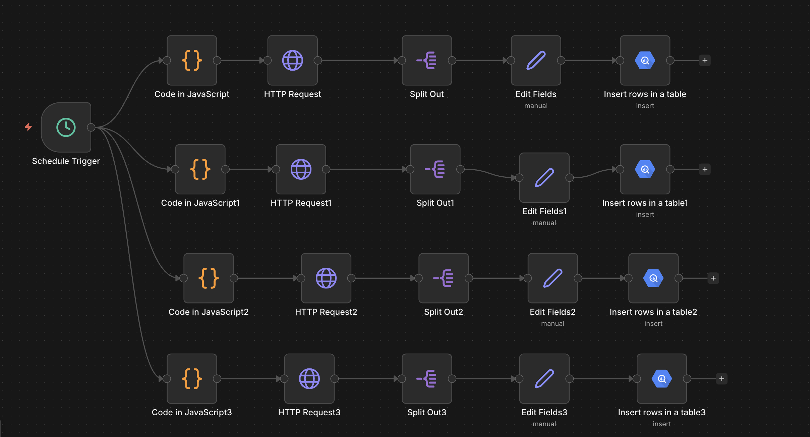

- **Four parallel branches,** one per Stripe endpoint: balance transactions, charges, disputes, refunds.
- **Day boundaries in Eastern time.** Stripe reports in Eastern time, so a Code node works out yesterday's midnight to midnight in America/New_York, with daylight saving handled by `Intl.DateTimeFormat`. Calculating "yesterday" in UTC put late evening orders on the wrong day, and daily revenue did not match Stripe until this was fixed.
- **Pagination:** Stripe's cursor (`starting_after` with the last ID on the page) until `has_more` is false.
- **Flattening:** an Edit Fields node turns Stripe's nested objects (billing details, card details, fee details, metadata like product SKU and coupon) into flat BigQuery columns. Every row gets an `ingested_at` time.

## BigQuery

All SQL is in [`queries/`](queries/).

**Staging (removes duplicates)**

Backfills and re-runs can load the same Stripe object twice. These views keep only the latest copy of each ID, and every reporting view reads from them, never from the raw tables.

| View | What it does |
|---|---|
| `stg_stripe_charges`, `stg_stripe_refunds`, `stg_stripe_disputes`, `stg_stripe_balance_transactions` | One row per Stripe ID, latest `ingested_at` wins |

**Reporting**

| View | What it answers |
|---|---|
| `fact_revenue` | One row per charge: gross, Stripe fee, refunds, dispute adjustments and the true net after all of them |
| `v_sku_performance` | Orders, gross and net revenue, refunds and disputes per product per day |
| `v_refund_dispute_rates` | Daily refund, dispute and chargeback counts, amounts and rates |
| `view_refund_dispute_tracking` | Every refund, failed charge and dispute in one table, with readable failure reasons |
| `v_refund_timing_overall` | Refunds bucketed by days after purchase (0-3, 4-14, 15-21, 21+) |
| `v_refund_by_sku` | Refund flag per charge, for refund rate by product |
| `v_dispute_reasons` | Disputes by Stripe's reason code |
| `v_cohort_revenue` | Revenue and retention by first purchase month, M0 to M11 |
| `v_cohort_refund_dispute_rate` | Refund, dispute and total loss rate by cohort |
| `v_cohort_refund_timing` | Refund timing buckets by cohort |
| `v_cohort_repeat_purchase_rate` | Share of each cohort that ordered again |
| `v_first_repeat_revenue` | Each charge tagged as first order or repeat |
| `v_customer_value_distribution` | Customers grouped into one-time, active (2-3 orders) and long-term (4+) |
| `v_ltv_distribution` | Customers grouped into lifetime value bands |

**How true net is calculated (`fact_revenue`)**

Stripe fees sit on the balance transaction, refunds sit on separate balance transactions linked through the refund, and lost disputes show up as adjustments linked through the dispute. True net adds all three back to the charge:

`true_net = charge net after fees + refund balance transactions + dispute adjustments`

## Dashboard

| | |
|---|---|
| 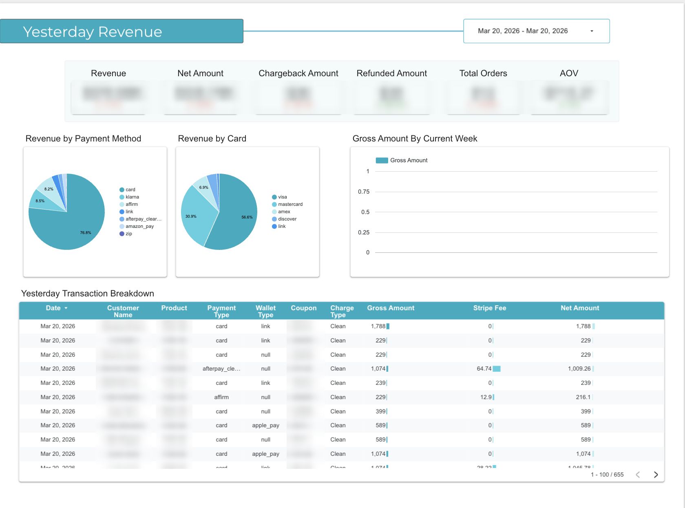 | 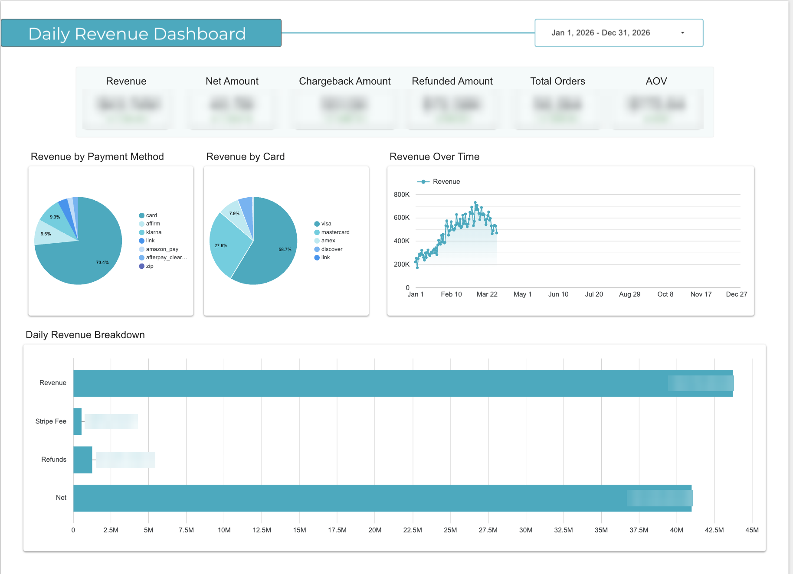 |
| 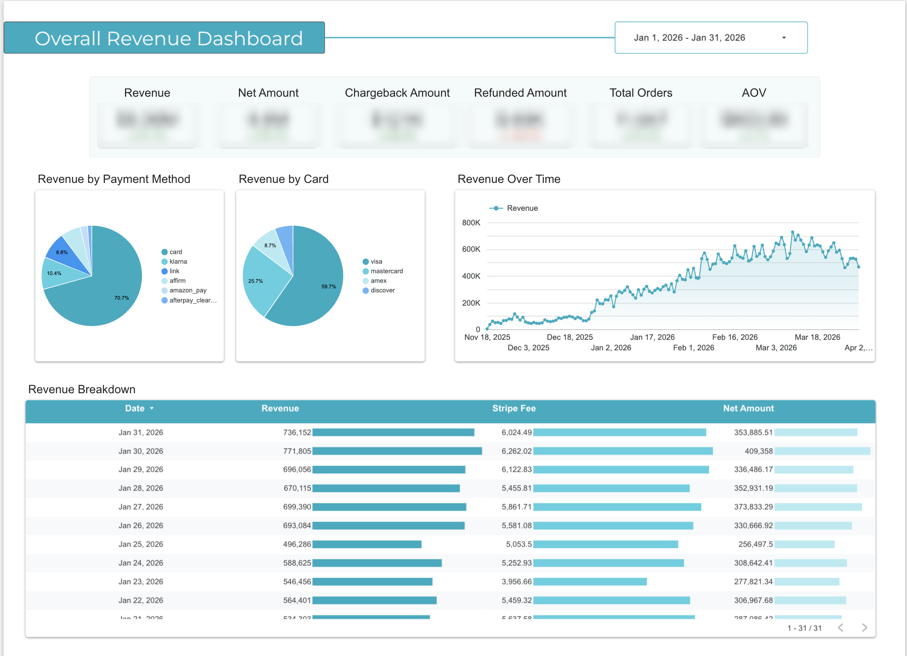 | 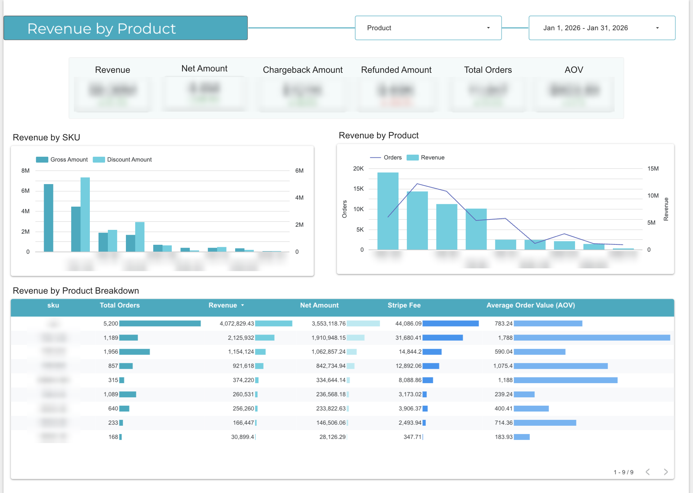 |
| 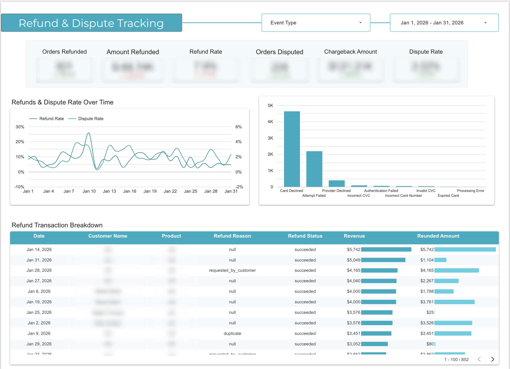 | 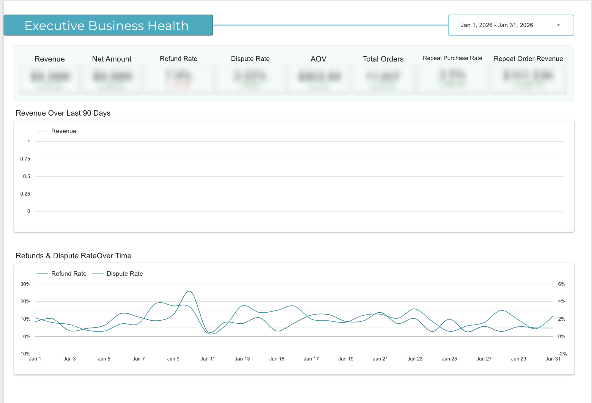 |
| 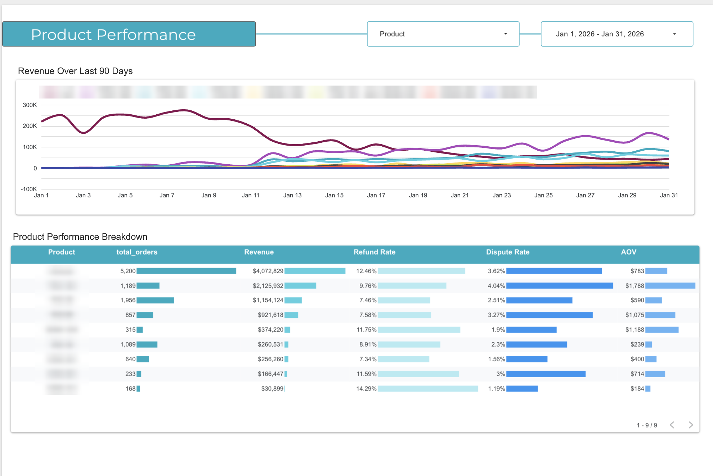 | 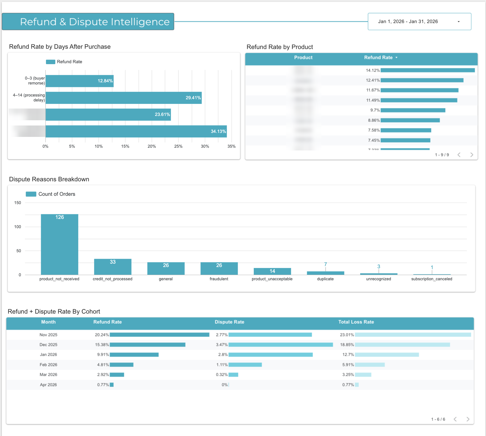 |
| 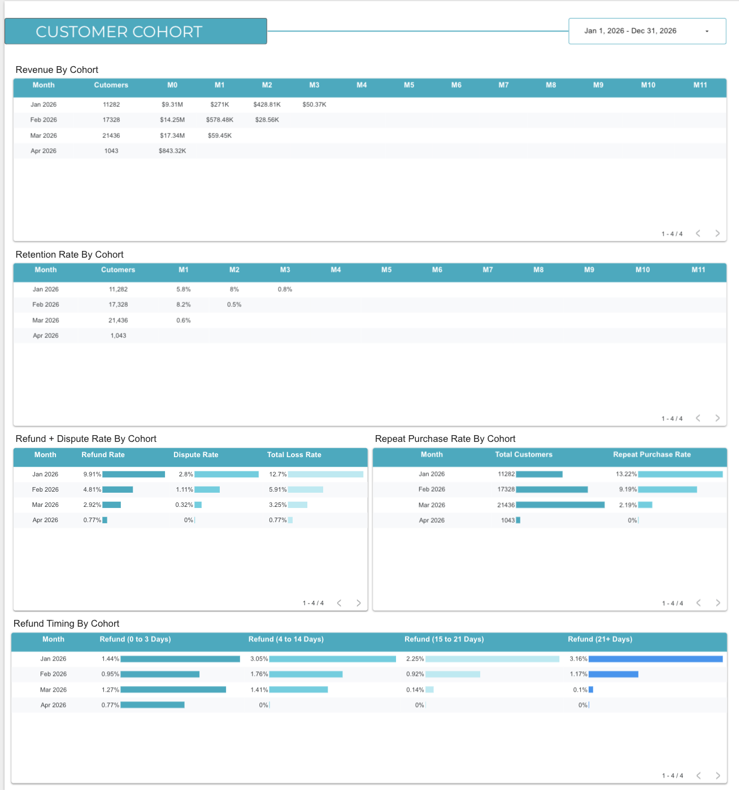 | 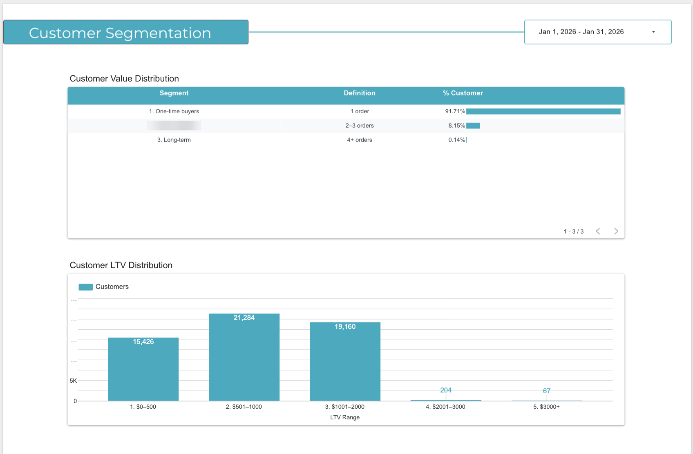 |

## Problems found and fixed

1. **Daily revenue did not match Stripe.** The load calculated "yesterday" in UTC while Stripe reports in Eastern time. Rewrote the date window in Eastern time with automatic daylight saving, backfilled, and gross volume matched Stripe exactly.
2. **Duplicate rows inflated every number.** Backfills appended to data that was already there. Fixed with the `stg_` views above, so a re-run can never double count.
3. **Refund rates above 100%.** Rates were calculated per day in BigQuery, and Looker Studio summed those percentages across a date range. The views now expose the counts (refunds, disputes, orders) so Looker recalculates the rate correctly for any date range.
4. **Client could not open the report.** Pages backed by BigQuery showed "insufficient permissions". Switched the Looker Studio data sources to owner's credentials so viewers do not need BigQuery access.

## Results

- Gross volume matches Stripe exactly
- Daily automated refresh, no manual exports
- Product profitability after fees, refunds and disputes
- Cohort retention and lifetime value, which Stripe alone does not show
- Refunds and disputes broken down by timing, product and reason
