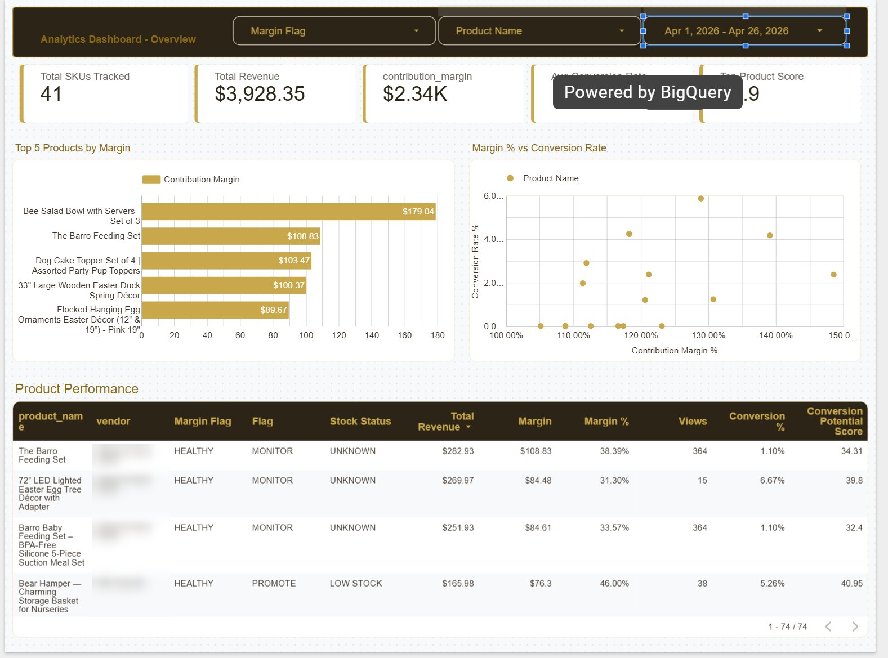
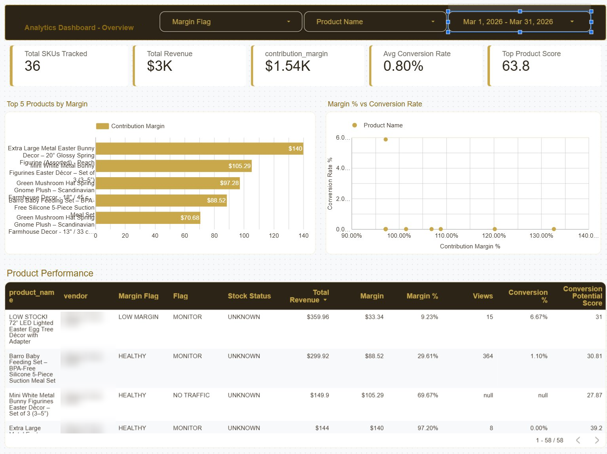
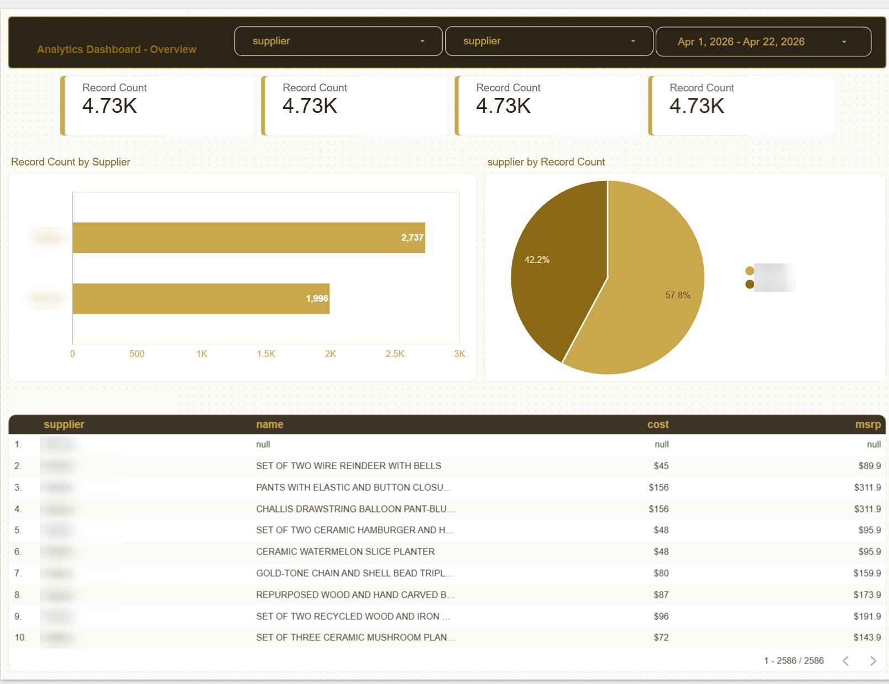
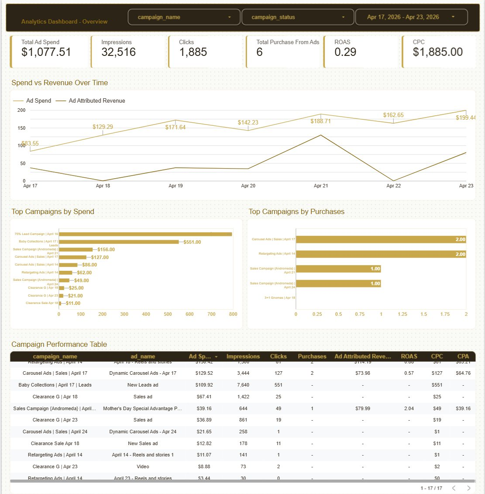

# Ecommerce Automation and Profit Dashboard

**Stack:** Google Apps Script, Google Sheets, Make, Shopify, BigQuery, Windsor.ai, GA4, Meta Ads, Looker Studio

An online home decor store buys from wholesale suppliers and resells on Shopify, with paid ads on Meta. The business was growing but could not answer basic questions: which products make money after all costs, which supplier is worth ordering more from, which listings get traffic but never sell, and which products are quietly sold at a loss.

- Supplier catalogs arrived as raw Excel files with thousands of rows, so products were picked by eye
- Cost sat in supplier sheets and selling price in Shopify, so true margin was never calculated
- Out of stock products stayed live because nobody checked supplier stock every week
- Shopify, Meta and GA4 each reported their own numbers, and nothing tied them together

I built it in five phases: a product scoring engine, automated listing and delisting, a BigQuery pipeline, and a profit dashboard on top.

> Store name, supplier names and vendor names are removed. Suppliers appear as "Supplier A" and "Supplier B".
>
> Because of the client's security restrictions I cannot share the SQL or the Make scenarios. The Apps Script, the model description and the screenshots below show what was built.

## Phase 1: Product scoring engine (Apps Script)

[`apps-script/product_scoring.gs`](apps-script/product_scoring.gs)

One supplier ships almost 2,900 products every season. The script reads both raw supplier catalogs and scores every product out of 100 across ten parts:

| Part | Max points | Based on |
|---|---|---|
| Gross margin | 18 | Margin %, capped at 65% |
| Dollar margin | 12 | Profit per unit in dollars |
| Price position | 12 | Whether the price sits in the sweet spot for that product type |
| Stock | 10 | Units available |
| Reorder depth | 10 | Whether it can be restocked |
| Category strength | 10 | How well the category sells |
| Set size | 8 | Multi piece sets carry a higher order value |
| Multi function | 7 | Products with more than one use (planter and vase, tray and serving) |
| Handmade | 8 | Words like handcrafted, artisan, rattan, terracotta in the product copy |
| Trend | 5 | Current home decor trend words |

- **Three pools:** furniture, big ticket (non furniture at $150 and up) and accessories are scored on different price and stock bands, because a $500 console table and a $20 vase should not be judged the same way.
- **Automatic exclusions:** discontinued, freight only (non furniture), zero stock (under 5 units for furniture), or missing cost or price.
- **Tiers:** Strong Buy at 72+, Consider at 58 to 71, Low Priority below 58.
- **Keyword override:** the buyer can type themes like `bee, butterfly, mushroom` before running. The script previews the matches first (to catch typos), then pulls up to five matching products per supplier into the Top 15.
- **Output:** a full ranked tab per supplier and a combined Top 15. Supplier A's Top 15 reserves up to five furniture slots and five keyword slots, and fills the rest on merit.

## Phases 2 and 3: Inventory automation (Make)

- **Upload:** one menu action pushes the chosen products to Shopify through a Make scenario and records them in a Posted Products tab, which becomes the list the inventory flows watch.
- **Delist:** compares every posted SKU against the latest supplier stock. Anything at zero goes to a Delist Queue for review, and approved items are removed from Shopify and logged.
- **Relist:** checks delisted products against fresh stock, and approved items go back live.
- History tabs stop the system acting on the same product twice.

## Phase 4: BigQuery pipeline

Sources: Shopify orders and Meta Ads through Windsor (daily), GA4 through the native BigQuery export (daily), and a supplier cost master table.

| View | What it does |
|---|---|
| `shopify_with_supplier` | Joins every order line to its supplier cost |
| `contribution_margin` | True profit per order line after cost of goods, payment fees and shipping |
| `ga4_events_clean` | Product level events from the raw GA4 export |
| `ga4_product_funnel` | Views, add to cart, checkout and conversion rate per product |
| `product_stock` | Latest stock per SKU |
| `sku_performance` | Revenue and profit per product |
| `product_master` | Everything joined, with flags and the potential score |

**Contribution margin per order line** = line revenue + shipping paid by the customer - cost of goods - payment fee. The fee uses the store's real plan rate (2.7% + 30 cents per order), split across the items in the order. Cost of goods uses supplier cost, falling back to the Shopify unit cost.

**Flags per product:**
- Stock: In Stock (over 5), Low Stock (1 to 5), Out of Stock
- Margin: Healthy (15%+), Low Margin (0 to 15%), Loss Making (below 0)
- Action: Promote (conversion 3%+ and margin 40%+), Reprice or Drop (negative margin), Fix Product Page (50+ views, under 1% conversion), No Traffic, Monitor
- Conversion potential score: margin 40%, conversion rate 40%, traffic 20%, to decide where the next ad dollar goes

## Phase 5: Dashboard

| | |
|---|---|
|  |  |
|  |  |

## What the data showed

- **A product line sold at a loss.** Three variants of a seasonal figurine sold at $29.99 against a $72 unit cost, losing $35 to $40 on every sale for weeks. The margin flag caught it on the first run.
- **The best line was not the one being pushed.** One range returned 80 to 85% contribution margin while ad budget went elsewhere.
- **Traffic without sales.** A product with 150 views and no purchases was flagged Fix Product Page.
- **Ad return needed checking.** ROAS came out at 0.29, which flagged the Meta pixel setup for verification.

## Checked against the source

- Revenue matched raw Shopify exactly
- Meta spend $1,735 vs Ads Manager $1,731 (one partial day of sync)
- GA4 purchases 32 vs Shopify orders 31 for the same window
- Contribution margin recalculated by hand on a live order and matched to the cent
- Looker date filters checked against BigQuery for two months
