# Mobile App Analytics (social video app)

**Stack:** GA4 for Firebase (BigQuery export), Meta Ads, Google Ads, TikTok Ads, BigQuery SQL views, Looker Studio

A creator economy mobile app (iOS and Android) where consumers follow content creators in a social feed and order personalised videos from them. The team had raw GA4 events and three ad platforms, but no way to see the whole journey from ad spend to install, signup, engagement, creator activity and paid orders.

I built the reporting layer on the GA4 BigQuery export: a flattened event base, 24 SQL views and a 12 section Looker Studio report covering marketing, acquisition, the user journey, feed and feature usage, content sharing, monetisation, creators, retention and app health.

> App name, user names, creator names and campaign names that contain people's names are blurred. The SQL is the real SQL, with project and dataset names replaced (`your-project`, `analytics_XXXXXXXXX`).

## How it works

```
GA4 app export (events_*)                 Meta Ads, Google Ads, TikTok Ads
        |                                          |
vw_base_flat: one row per event,           ads_unified: one schema for
params and user properties unnested        spend, clicks, impressions, installs
        |                                          |
        +----------- reporting views --------------+
                          |
               Looker Studio (12 sections)
```

## The retention fix (the most important piece)

The client saw retention jump to impossible levels on some days and could not trust the chart.

**What I found:** the old view counted *any* GA4 event as a returning user. Android logs `notification_receive` and `notification_dismiss` in the background when a push notification arrives, even if the app is never opened. iOS does not. On days with a mass push campaign, about 2,400 Android users "returned" without opening the app, against 250 to 370 really active ones. Every spike in the chart lined up with a push day. Uninstalls (`app_remove`) and OS updates were also being counted as returns.

**Other problems in the same view:**
- The cohort date was "first seen inside a rolling 120 day window", so on the first day of the window 89.6% of the "new" users were old users.
- Immature cohorts (for example D30 for users who installed last week) showed 0 instead of blank, which pulled averages down.

**Fix ([`v_retention_daily.sql`](queries/v_retention_daily.sql)):**
- Background events (`notification_receive`, `notification_dismiss`, `app_remove`, `app_clear_data`, `os_update`, `app_update`) no longer count as a return.
- The cohort date looks back to the start of the export, so old users are never labelled new.
- D1, D7 and D30 stay blank until the cohort is old enough, using the latest export table from `INFORMATION_SCHEMA` instead of today's date.

I tested four versions side by side before choosing. The final version matched an "app open only" definition within 0.7 points (D1 17.7% vs 17.9%, D7 5.5% vs 5.5%), with no more push day spikes.

## BigQuery views

All in [`queries/`](queries/).

| Area | Views |
|---|---|
| Base | `vw_base_flat` (events flattened: event params, user properties, traffic source), `ads_unified` (Meta, Google Ads and TikTok in one schema) |
| Acquisition | `vw_user_acquisition_funnel` (install, first screen, signup, first interaction, active user, per day, platform and campaign), `vw_signup_authentication` (signup method and success rate) |
| User journey | `vw_user_journey_funnel`, `vw_user_type_distribution`, `vw_new_user_type` (guest, consumer, contributor) |
| Feed and features | `vw_post_engagement`, `vw_interaction_count`, `vw_feature_usage`, `vw_notification_interaction`, `v_user_screen_time` (time per user per screen) |
| Sharing | `vw_content_shares`, `vw_video_share_stats` |
| Monetisation | `vw_order_funnel`, `vw_order_funnel2` (profile view, start request, submit, payment, completed), `vw_order_completion_rate` |
| Creators | `vw_contributor_activity`, `vw_contributor_trend` |
| Retention | `v_retention_daily` (D1, D7, D30), `installxreturningxuser` (cohort grid D0 to D30), `v_retention_by_action` (retention where the start and return actions are chosen in a filter, for example install then like) |
| App health | `v_dau_wau_mau`, `vw_session_activity` (sessions per user, screens per session, session length, returning share) |

**Screen time per user (`v_user_screen_time`):** GA4 gives total engagement time per session but not per screen. The view uses GA4's own engagement time as the total, and the gaps between screen view timestamps only to split that total across screens. Time after the app comes back to the foreground goes to the last screen. Daily totals reconcile with GA4 engagement minutes.

## Dashboard

The report has 12 sections ([page list](screenshots/00_dashboard_pages.png)).

| | |
|---|---|
| 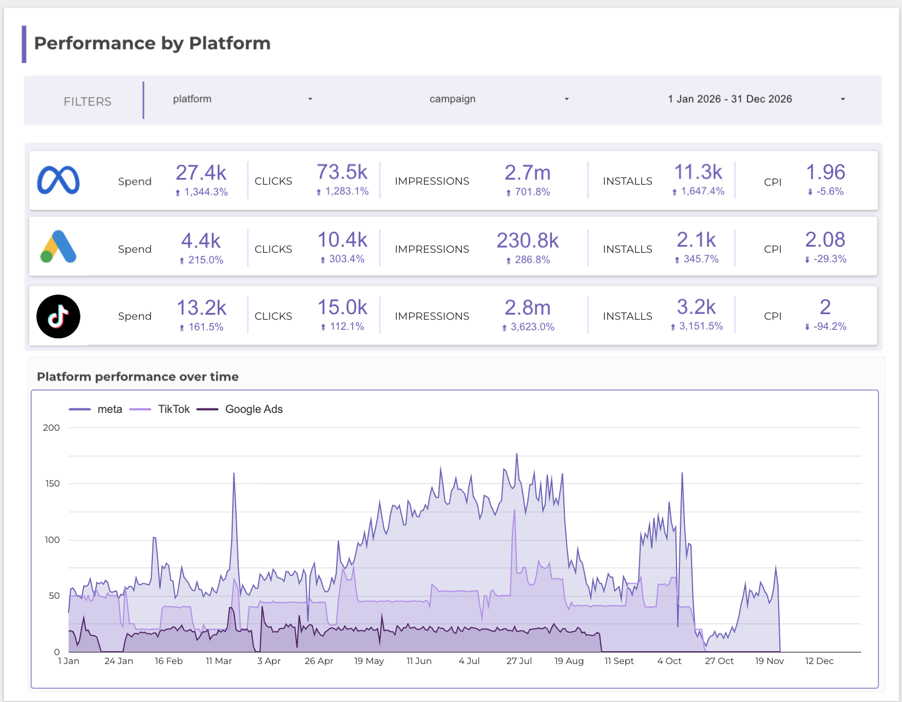 | 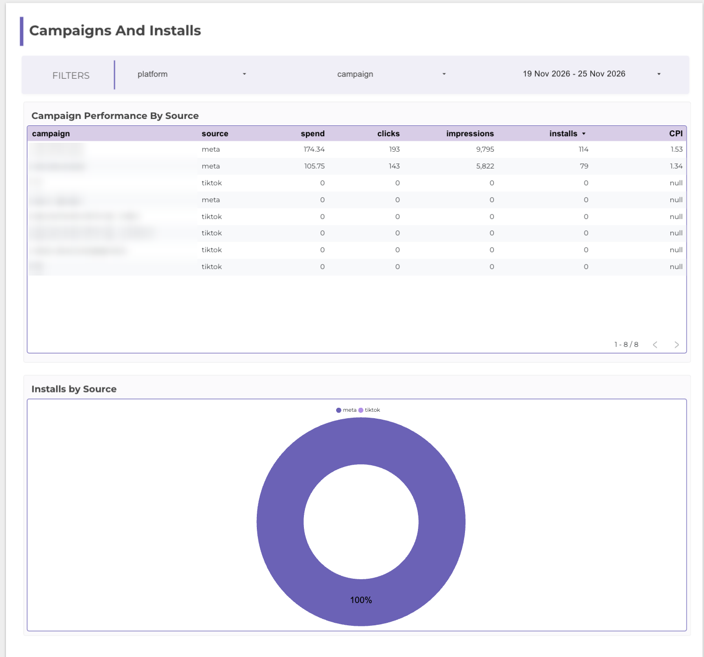 |
| 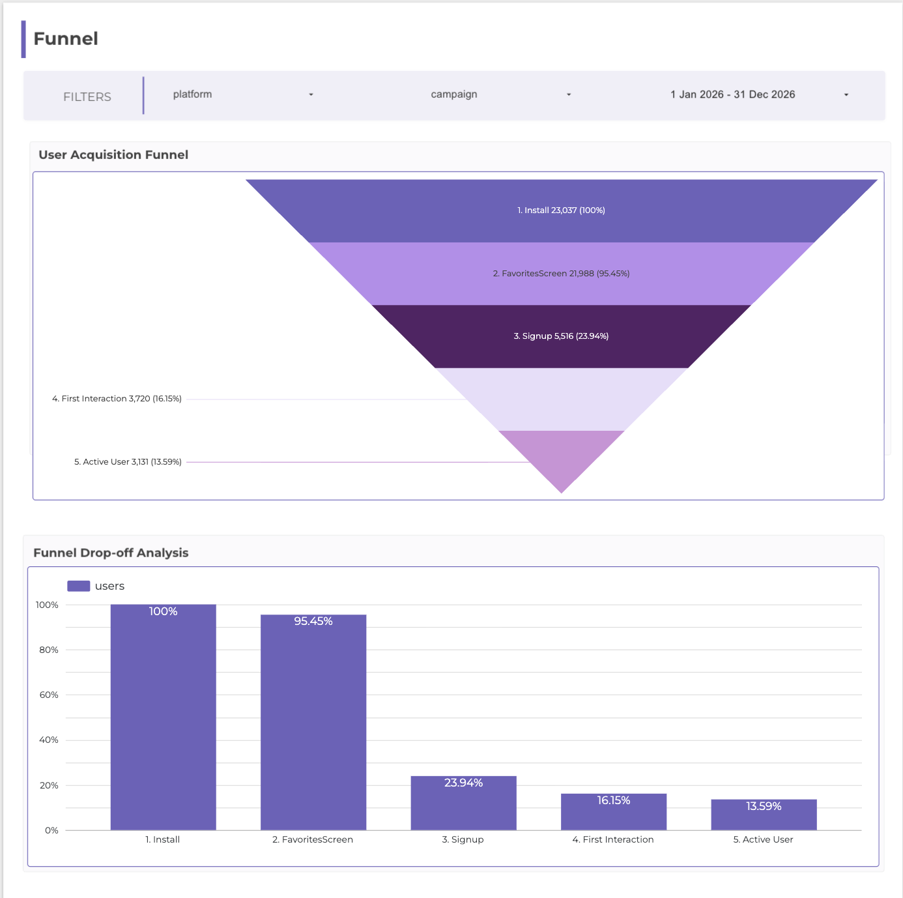 | 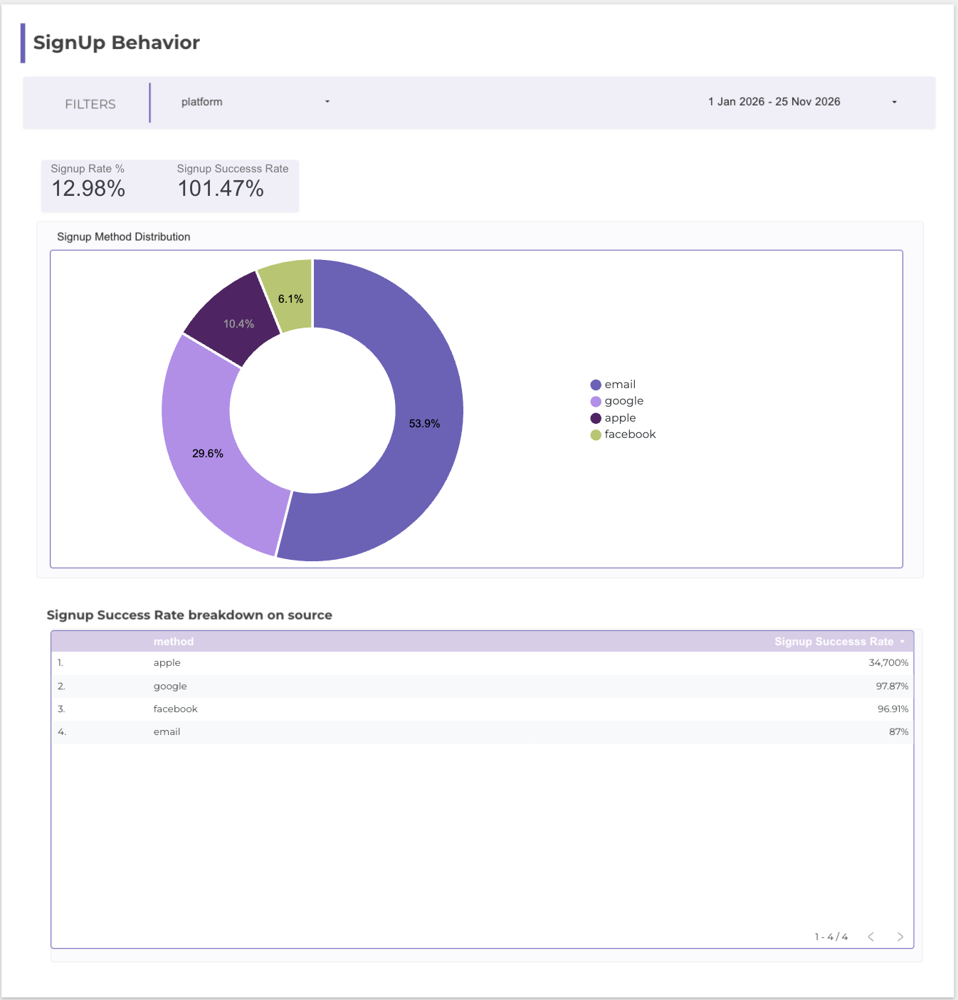 |
| 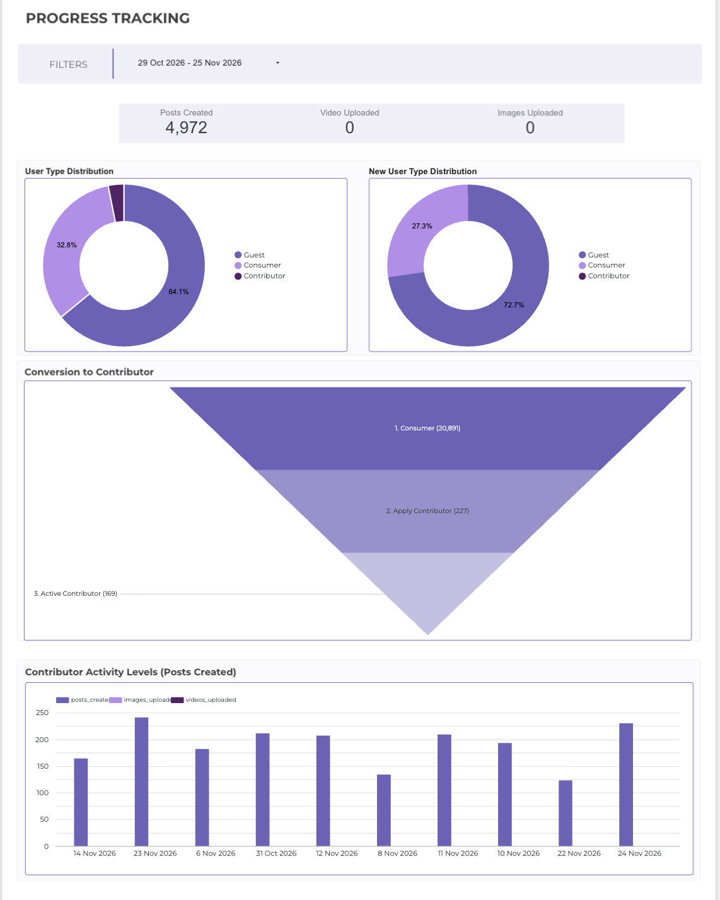 | 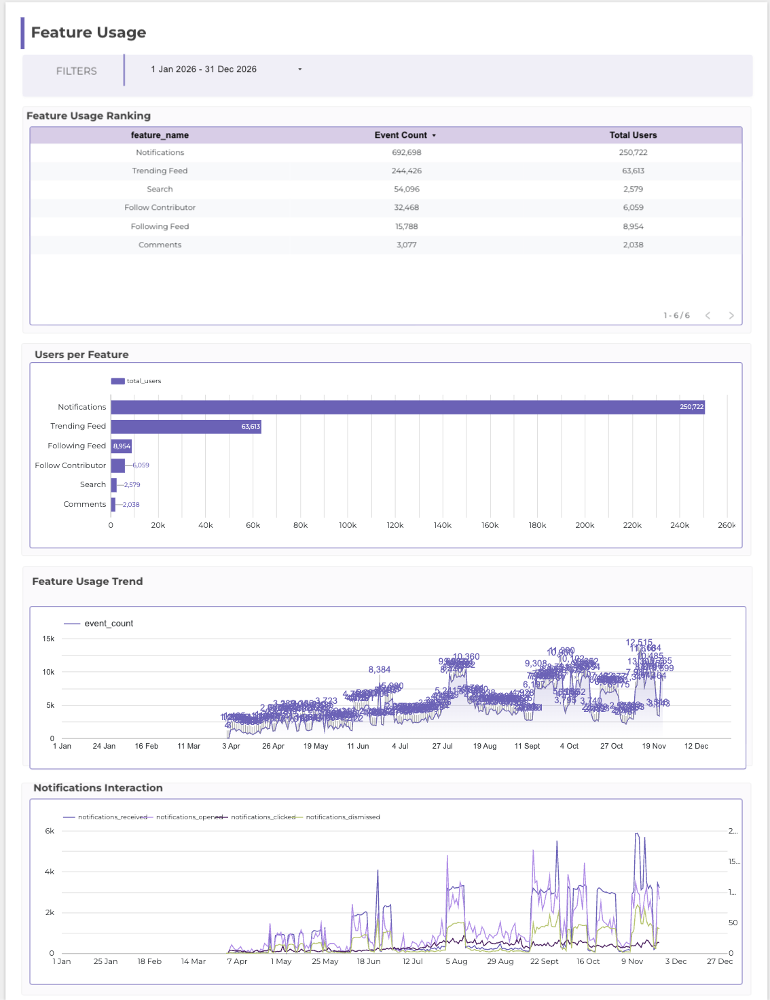 |
| 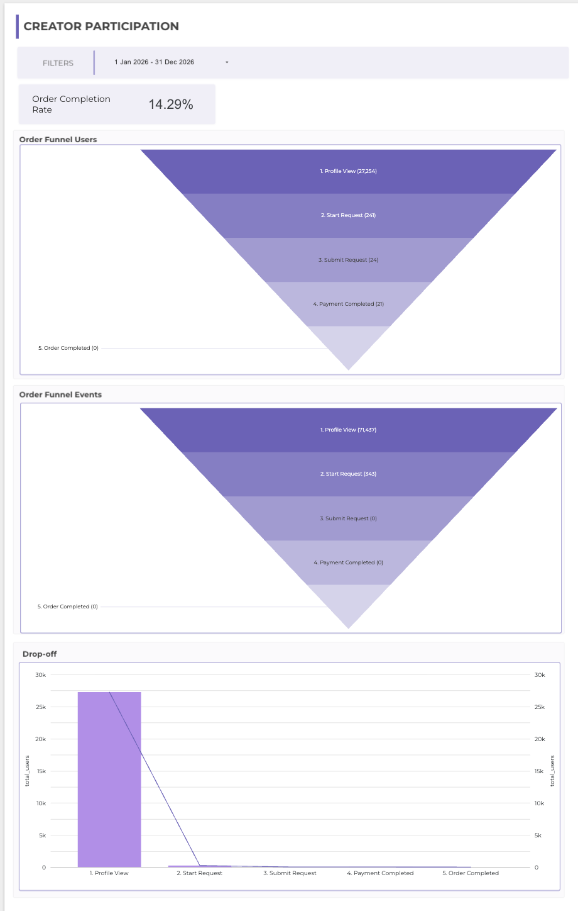 | 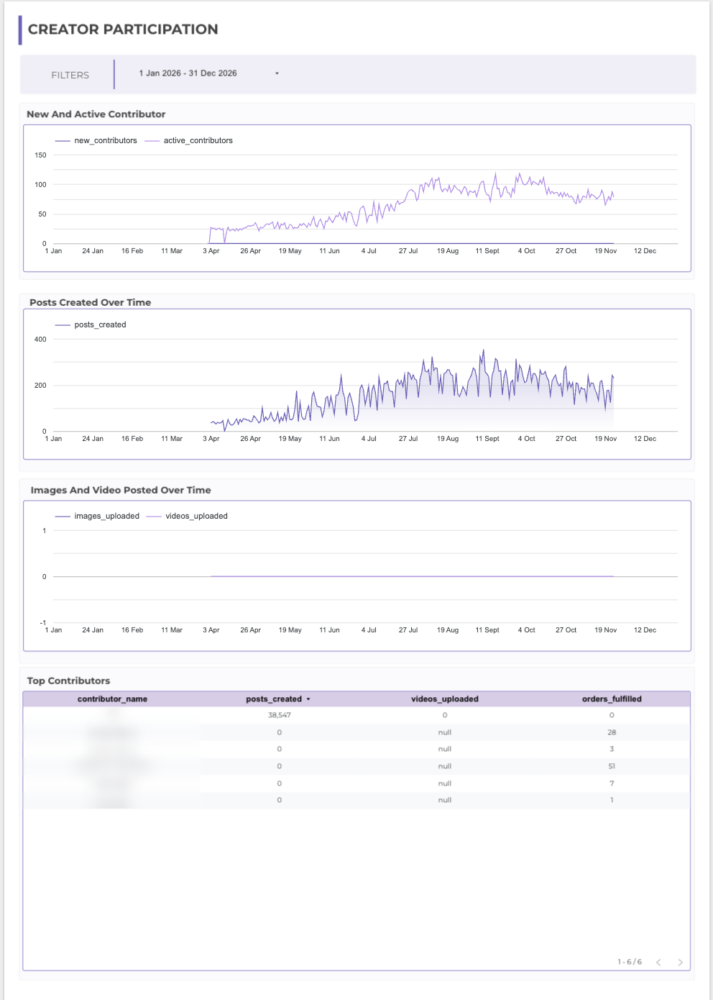 |
| 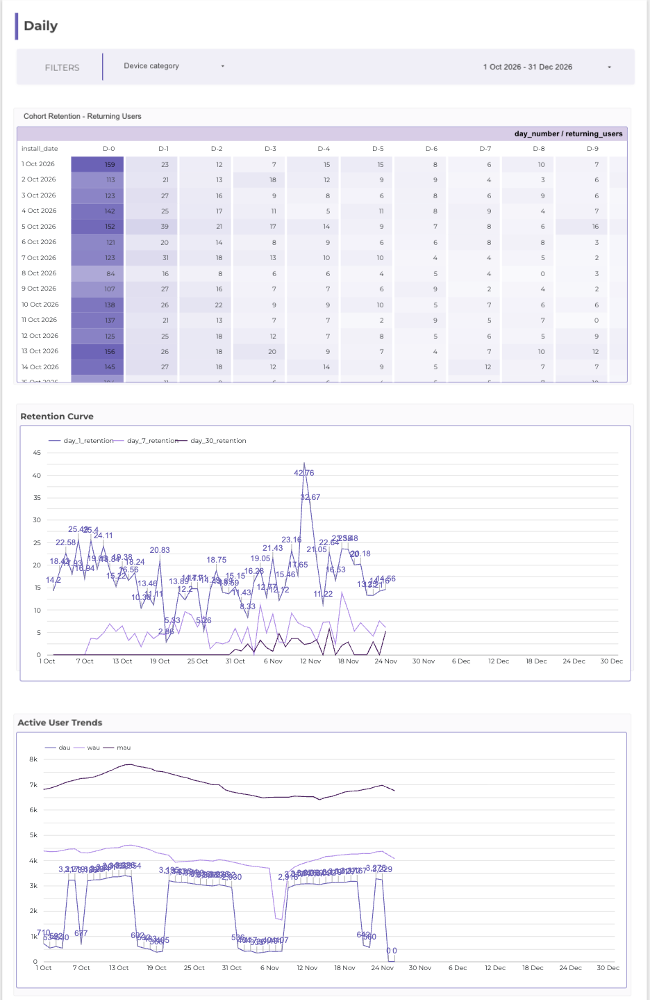 | 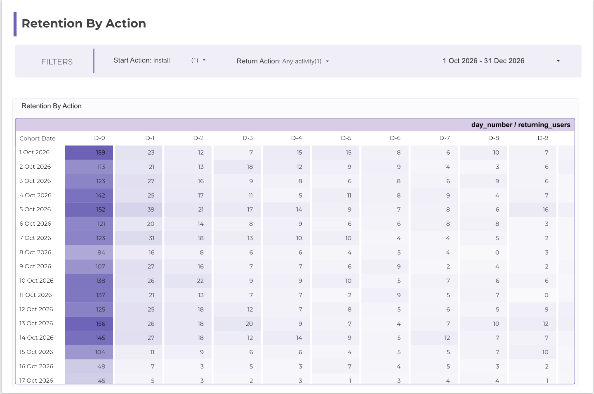 |
| 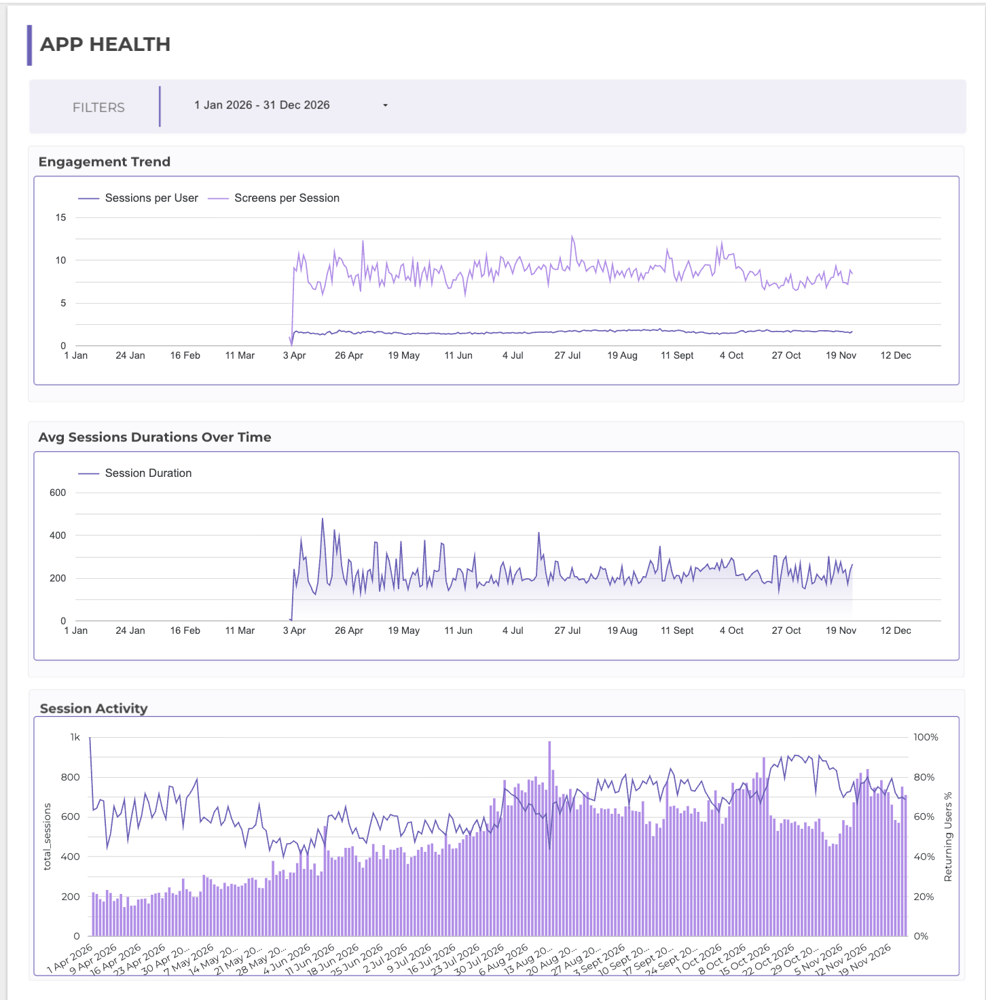 | 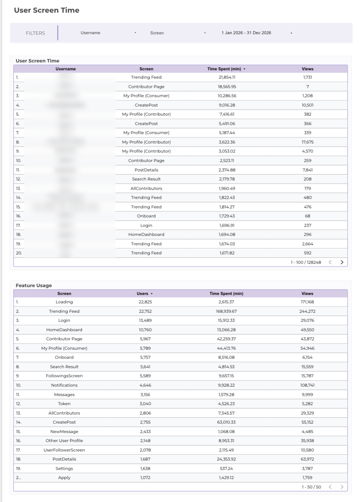 |

More pages: [Meta campaigns](screenshots/03_campaign_performance_meta.png), [installs](screenshots/04_installs_trends.png), [spend](screenshots/05_spend.png), [CPI](screenshots/06_cpi.png), [funnel by day](screenshots/08_funnel_daily.png), [feed interaction](screenshots/11_feed_interaction.png), [content sharing](screenshots/14_content_sharing.png).

## Results

- One view from ad spend to install, signup, engagement and paid video orders
- Cost per install compared across Meta, Google Ads and TikTok, down to campaign
- Retention the team can trust: real D1 mostly 10 to 25%, D7 3 to 8%, D30 1 to 4%, with no fake spikes
- Retention by action, so the team can see whether users who like, comment or follow come back more often
- Creator supply and the video order funnel tracked from profile view to completed order
