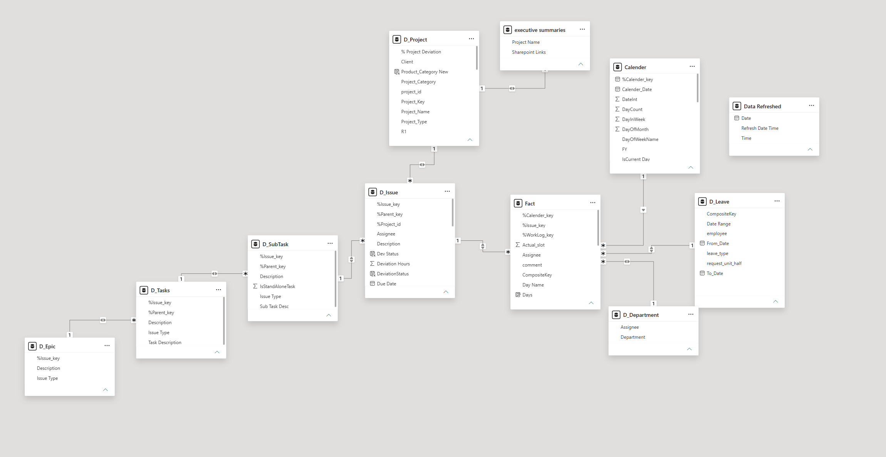
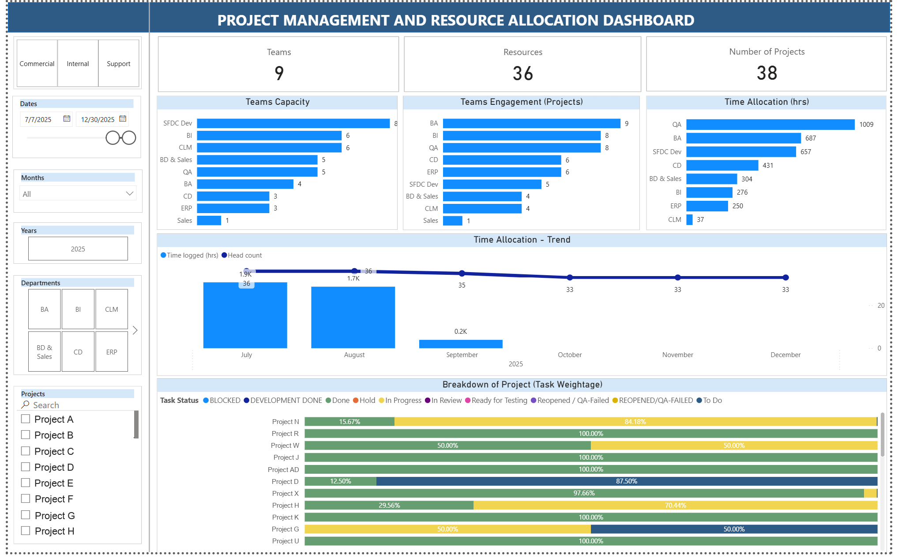
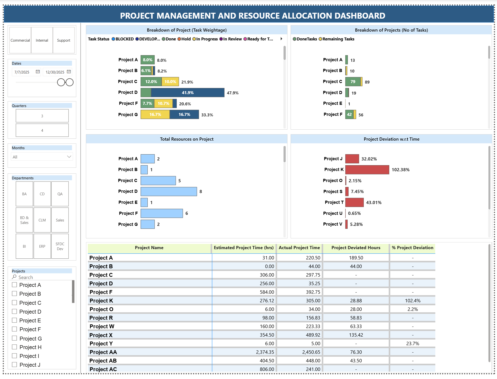
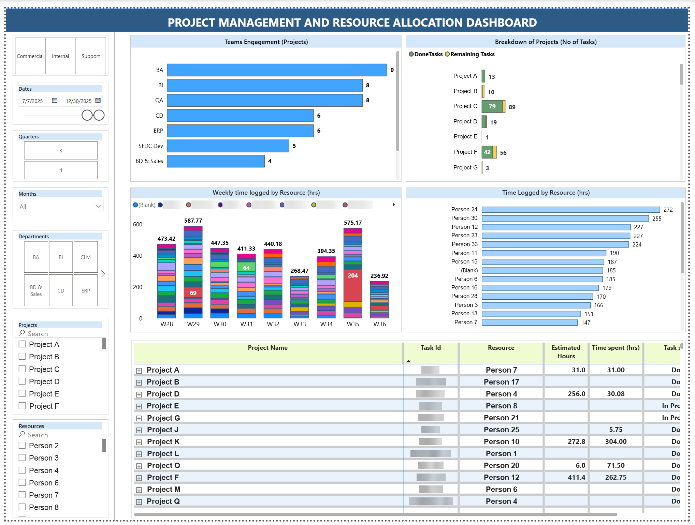
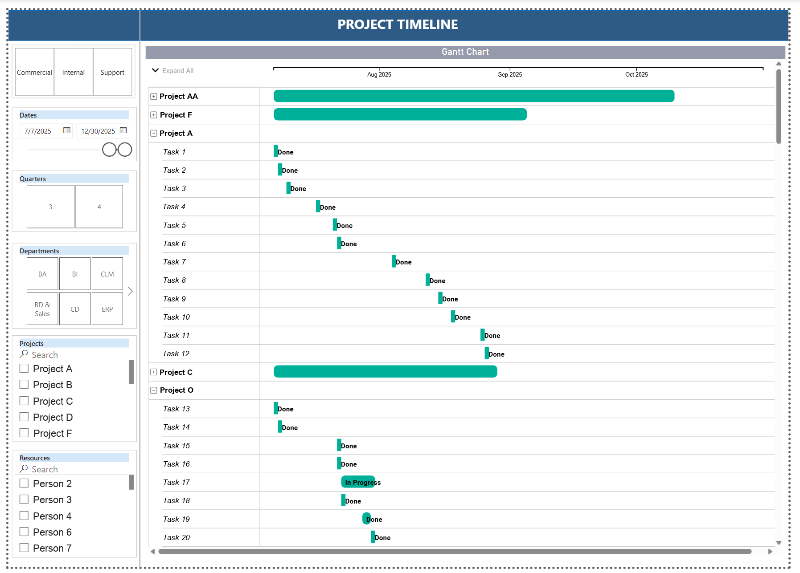
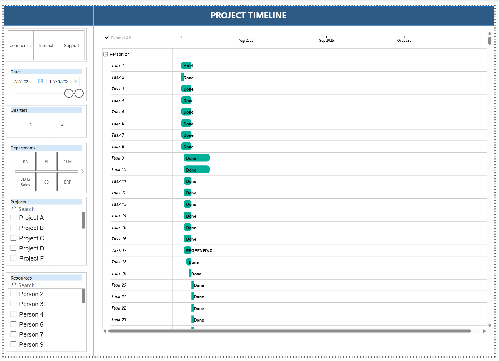
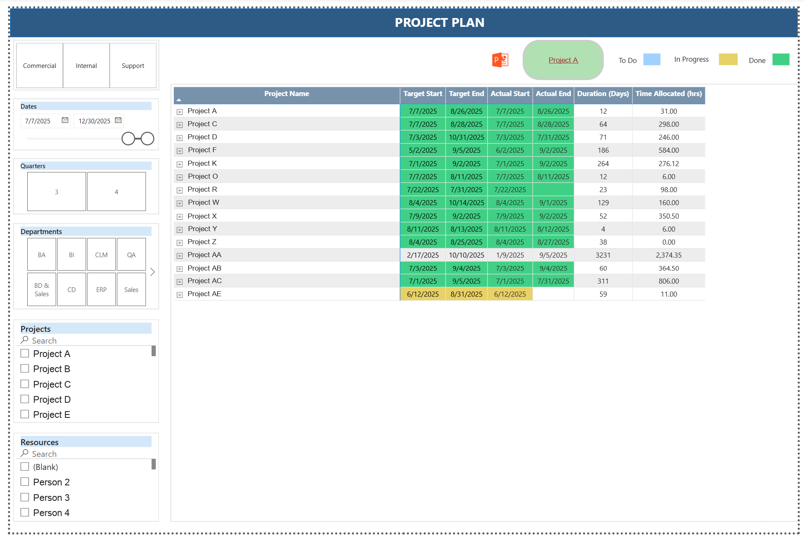
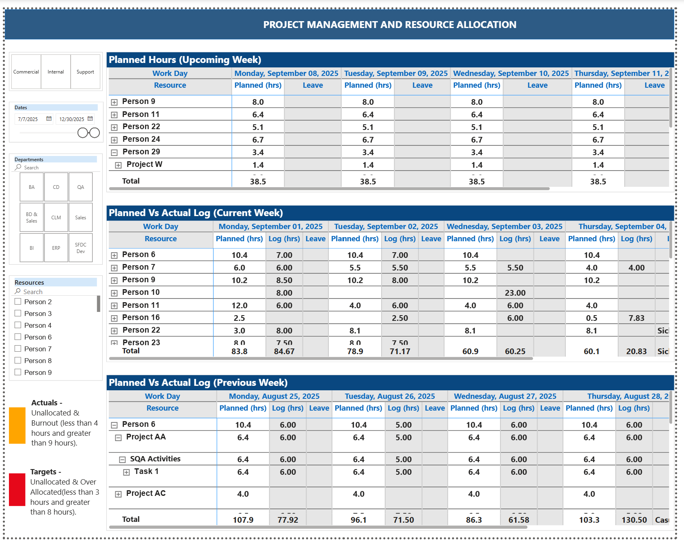
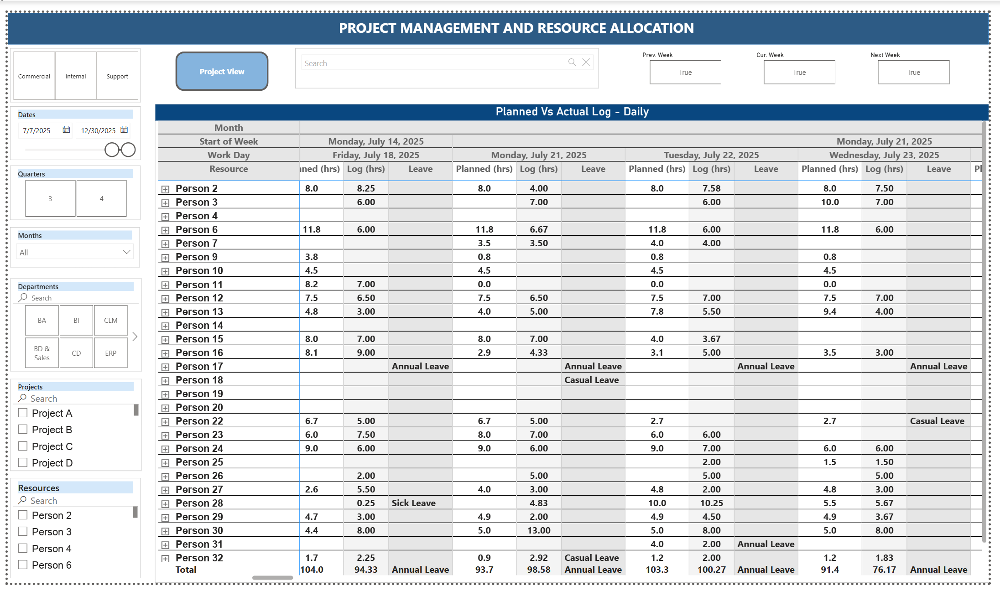

# Project Management and Resource Allocation (Power BI, Jira data)

> This is a real client dashboard. Project, client and people names have been replaced
> ("Project A", "Person 1", "Task 1") or blurred, and the company logo has been removed.
> The same name always gets the same label on every page. The raw data is not included.

## Situation

A services company ran many client projects and internal projects at the same time, across 9 teams
(BA, BI, QA, CD, CLM, ERP, SFDC Dev, BD & Sales, Sales). Managers had no single place to see:

- how many people each team has and how busy they are
- how many hours were logged against how many were planned
- which projects are on time, which are over their estimate, and by how much
- who is over allocated, under allocated or on leave this week

I built one Power BI report that answers these questions from the Jira data the teams already use.

## Data and refresh

- Source: Jira issues and worklogs, exported as JSON.
- The developers' automation refreshes the JSON every 4 hours.
- Power BI refreshes on top of that, so the report is never more than a few hours behind Jira.
- A small `Data Refreshed` table holds the last refresh date and time, so users can see how fresh the numbers are.

## Data model

A star model built around worklogs.

**Issue hierarchy.** Jira work is nested, and each level has its own table, linked child to parent through `%Parent_key`:

`D_Epic` > `D_Tasks` > `D_SubTask` > `D_Issue`

`D_Issue` is the lowest level and holds what the report needs per issue: assignee, description,
dev status, due date, deviation hours and deviation status. This lets any number roll up from an
issue to its sub task, task, epic and project.

**Fact.** One row per worklog (`%WorkLog_key`), with the actual hours logged (`Actual_slot`),
the assignee, the day and a comment. It links to `D_Issue` on `%Issue_key` and to the calendar on `%Calender_key`.

**Dimensions around the fact:**

- `D_Project`: project name, key, type (Commercial, Internal, Support), category, client and `% Project Deviation`. Linked to `D_Issue` on `%Project_id`.
- `Calender`: date table with day in week, day of month, day name, fiscal year and an "is current day" flag. Drives the week and month slicers and the daily matrices.
- `D_Leave`: leave per employee with from date, to date, leave type and half day requests. It is used to take leave days out of a person's capacity, so planned hours are not expected on days someone is off.
- `D_Department`: maps each assignee to a team. This is what turns person level hours into team capacity and team allocation.
- `executive summaries`: one link per project to its executive summary document, used from the Project Plan page.
- `Data Refreshed`: last refresh date and time (standalone table).

## Pages

All pages share the same slicers on the left: project type (Commercial, Internal, Support),
date range, quarter or month, department, project and resource.

### 1. Summary

*Question: how big is the operation and where does the time go?*

- KPI cards: Teams (9), Resources (36), Number of Projects (38).
- Teams Capacity: head count per team.
- Teams Engagement (Projects): how many projects each team is working on.
- Time Allocation (hrs): hours logged per team.
- Time Allocation Trend: hours logged per month (columns) against head count (line).
- Breakdown of Project (Task Weightage): one 100% bar per project, split by task status (Done, In Progress, To Do, Blocked, In Review, Ready for Testing, Reopened / QA Failed and others).

### 2. Projects Overview

*Question: which projects are on track and which are running over?*

- Breakdown of Project (Task Weightage): share of each project's work by task status.
- Breakdown of Projects (No of Tasks): done tasks against remaining tasks.
- Total Resources on Project: number of people who logged time on each project.
- Project Deviation w.r.t Time: % deviation per project, in red.
- Table: Estimated Project Time (hrs), Actual Project Time, Project Deviated Hours and % Project Deviation for every project.

### 3. Resource Overview

*Question: who is working on what, and how many hours are they logging?*

- Teams Engagement (Projects) and Breakdown of Projects (No of Tasks), as above.
- Weekly time logged by Resource (hrs): stacked weekly columns (W28 to W36), one colour per person.
- Time Logged by Resource (hrs): total hours per person, highest first.
- Table: project, task id, resource, estimated hours, time spent and task status, with a drill down per project.

### 4. Project Gantt

*Question: what is the timeline of each project?*

One row per project, expandable to its tasks. Each bar runs from start to end date and is labelled with the task status.

### 5. Resource Gantt

*Question: what is each person working on, and when?*

The same timeline, grouped by person instead of by project, so a manager can see one person's task queue.

### 6. Project Plan

*Question: did each project start and finish on the dates that were planned?*

- Table per project: Target Start, Target End, Actual Start, Actual End, Duration (Days) and Time Allocated (hrs).
- Date cells are coloured by status: To Do (blue), In Progress (yellow), Done (green).
- The selected project is shown at the top, next to a PowerPoint icon that links to that project's executive summary (from the `executive summaries` table).

### 7. Plan vs Actual Status

*Question: is everyone loaded correctly this week, last week and next week?*

Three matrices, one row per person (drill down to project and task), one column group per working day:

- Planned Hours (Upcoming Week): planned hours and leave per day.
- Planned Vs Actual Log (Current Week): planned hours, logged hours and leave per day.
- Planned Vs Actual Log (Previous Week): the same for last week.

Two colour rules flag problems:

- Actuals (orange): unallocated or burnout, less than 4 or more than 9 logged hours in a day.
- Targets (red): unallocated or over allocated, less than 3 or more than 8 planned hours in a day.

### 8. Planned vs Logged (daily)

*Question: day by day, did each person log the hours that were planned for them?*

A daily matrix (Month > Start of Week > Work Day) with planned hours, logged hours and leave type
(Annual, Casual, Sick) for every person. Toggles switch between previous, current and next week,
and there is a search box and a "Project View" button.

## Key measures

These are the measures the visuals are built on:

- **Teams, Resources, Number of Projects**: distinct counts of departments, assignees and projects.
- **Team capacity**: head count per department (through `D_Department`).
- **Time logged (hrs)**: sum of worklog hours from the fact table, by person, team, project, week or month.
- **Head count trend**: distinct people logging time per month, shown against the hours.
- **Task weightage by status**: each status's share of a project's work, so one bar shows how much of the project is done, in progress or still to do.
- **Done tasks and remaining tasks** per project.
- **Total resources on project**: distinct people who logged time on it.
- **Estimated vs actual project time**: estimate from Jira against the hours logged.
- **Project deviated hours**: actual hours minus the estimate when the project runs over (blank when it is under).
- **% project deviation**: the deviation as a percentage, shown per project.
- **Planned hours per day**: planned work spread over a person's working days, with leave days taken out using `D_Leave`.
- **Plan vs actual per day**: planned hours, logged hours and leave side by side, with the over and under allocation thresholds above.

## Tools

Jira (JSON export, refreshed every 4 hours by the developers' automation), Power BI (Power Query, data model, DAX measures, conditional formatting, drill down matrices, Gantt visuals).
