# Customer Service Order Analytics on SAP Data (Power BI)

**Stack:** Power BI Desktop and Service, Power Query, DAX, SAP extracts (VBAK, LIKP, ZVTOUCH, customer master) in Excel, SharePoint

> This is a real client dashboard I built for a global consumer goods manufacturer. The brand, the logo, customer names and all IDs are removed from the screenshots. Customers appear as "Customer 1", "Customer 2" and so on, with the same number on every page. The raw SAP data is not included.

## Situation

The customer service team handles hundreds of thousands of sales orders across Europe and Africa. Many orders do not flow straight through: someone has to open them and change something (a delivery block, a requested delivery date, a price, a route, a credit block). Each of those manual changes is a "touch".

The team wanted to:

- Measure how much manual work orders need (touches per order, % manual orders, % touchless orders)
- Track automation against a target path over time (the glidepath)
- See where and why orders get touched: by cluster, country, segment, customer and SAP reason code
- Compare every month with the same month last year

## Data and refresh

| Source | What it holds |
|---|---|
| VBAK | Sales order headers: order, customer, sales org, order type, created by, net value |
| LIKP | Delivery headers: delivery type, document, delivery and loading dates, created by |
| ZVTOUCH | Order change log: one row per change to an order, with the SAP field description that changed |
| Customer master | Customer names and groupings |

- The data comes as monthly SAP extracts in Excel, from January 2021 to December 2025.
- The client's own automation uploads the new files to a SharePoint folder.
- Power BI reads the SharePoint folder, combines the monthly files in Power Query and refreshes on a schedule, so a new month shows up without anyone touching the report.

## Data model

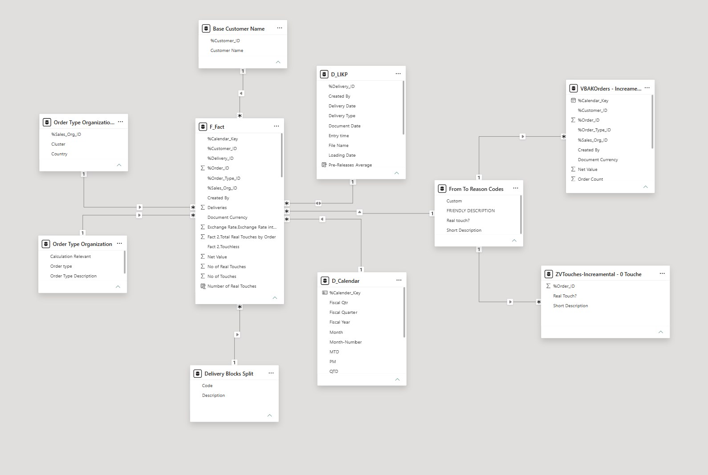

A star schema with one fact table in the middle:

- **F_Fact** holds one row per order with keys to every dimension (calendar, customer, delivery, order type, sales org) plus the measures base: number of touches, number of real touches, deliveries, net value, document currency and exchange rate. It also takes two order level columns from a helper table (Fact 2): total real touches per order and a touchless flag.
- **D_Calendar** gives fiscal year, fiscal quarter, month and the period helpers (MTD, QTD, previous month) used for the year over year and month over month views.
- **D_LIKP** is the delivery dimension (delivery type, document, delivery and loading dates, entry time, source file name). The pre-release average measure lives here.
- **Base Customer Name** maps the customer ID to a single customer name, so a customer with several sold-to accounts can be shown under one name.
- **Order Type Organization** (two tables) maps the sales org to cluster and country, and the order type to its description and to a "calculation relevant" flag that decides which order types count in the KPIs.
- **Delivery Blocks Split** decodes delivery block codes into descriptions.
- **From To Reason Codes** is the reason code mapping. Every SAP change description in ZVTOUCH is mapped to a friendly description (for example "Cuts & Rejected Orders", "Credit Block", "Delivery Block") and to a **Real touch?** flag. A real touch is a change a person made to fix or adjust the order. Changes that are part of normal processing are kept in the data but flagged as non real, so they do not inflate the touch count. The "Real" button on several pages switches the visuals to real touches only.
- **VBAKOrders - Incremental** and **ZVTouches - Incremental** are the order and touch tables loaded incrementally: each refresh appends the new monthly files instead of rebuilding five years of history, which keeps the refresh fast as the data grows.

## Pages

### 1. Overview

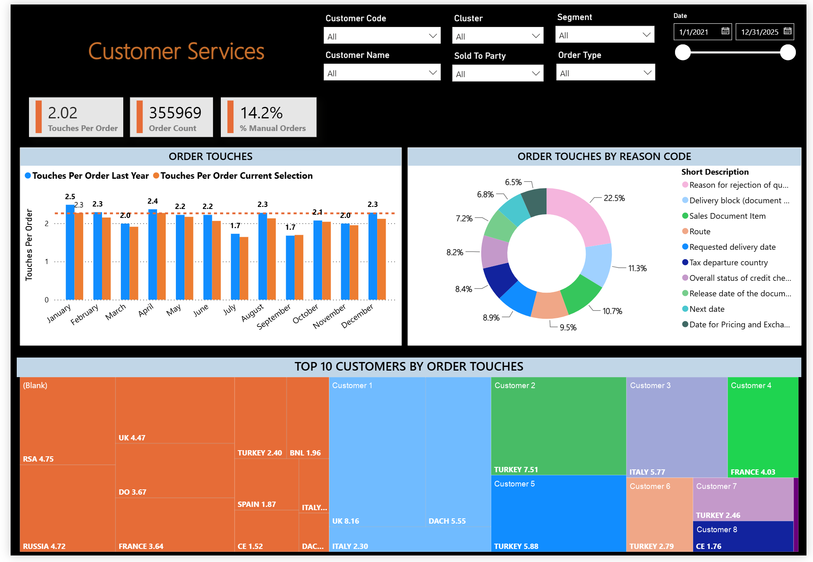

The landing page. Three headline cards: touches per order (2.02), order count (355,969) and % manual orders (14.2%). Below them, touches per order by month for the current selection against last year, with a dashed reference line, a donut of order touches by reason code (rejections of quotations and sales orders are the largest share at 22.5%, then delivery blocks, sales document items and route changes), and a treemap of the top 10 customers by order touches, split by cluster with touches per order on each tile. Slicers for customer code, customer name, cluster, segment, sold-to party, order type and date range.

### 2. KPI dashboard

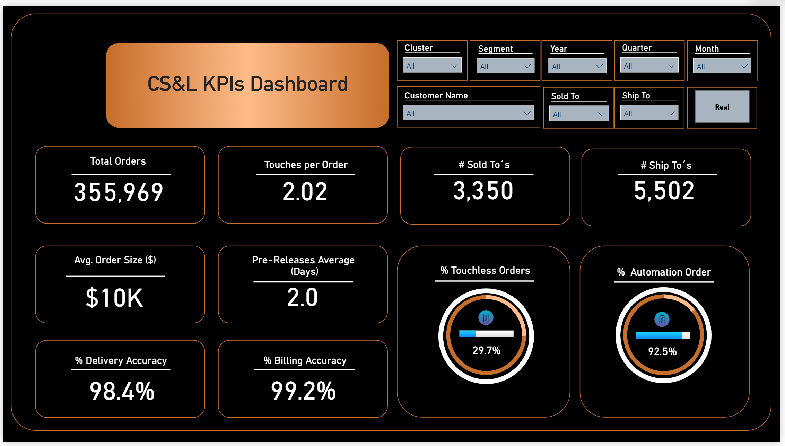

A one screen summary: total orders, touches per order, number of sold-to and ship-to accounts, average order size, pre-release average in days, % delivery accuracy (98.4%), % billing accuracy (99.2%), and two gauges for % touchless orders and % automated orders. Filters by cluster, segment, year, quarter, month, customer, sold-to and ship-to, plus the "Real" switch.

### 3. Order touches year over year

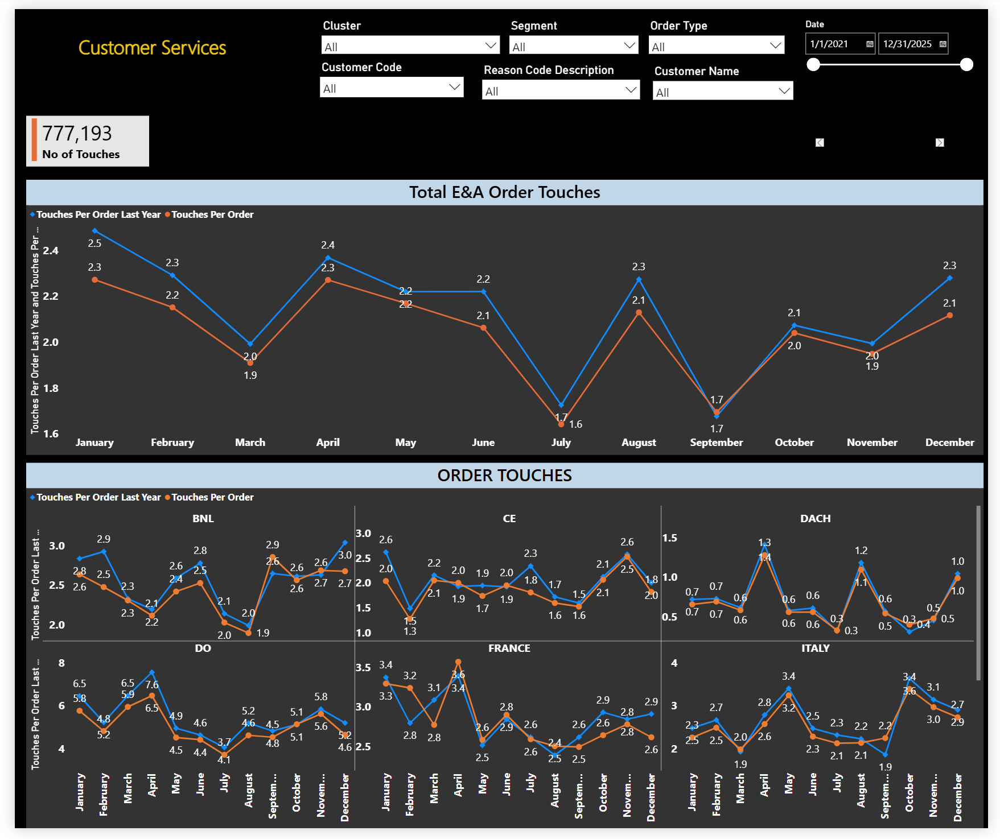

Touches per order by month, this year against last year, for the whole region and then as small multiples for each cluster (BNL, CE, DACH, DO, France, Italy and the rest on scroll). It answers whether a cluster is getting better or worse than the same month last year, and the reason code slicer narrows it to one type of change.

### 4. Order touches glidepath by reason code

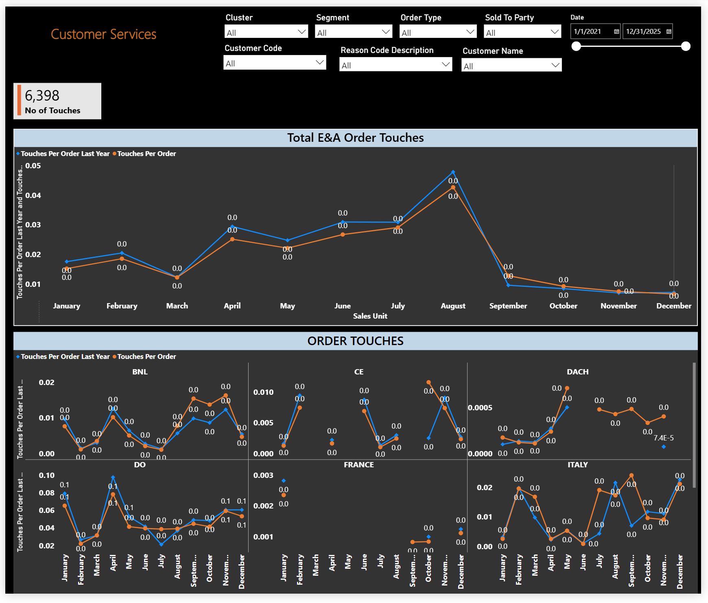

The same layout filtered to a single reason code (here a small one with 6,398 touches). Looking at one change type at a time shows which causes are shrinking and which are not, per cluster.

### 5. Touches per order, month over month

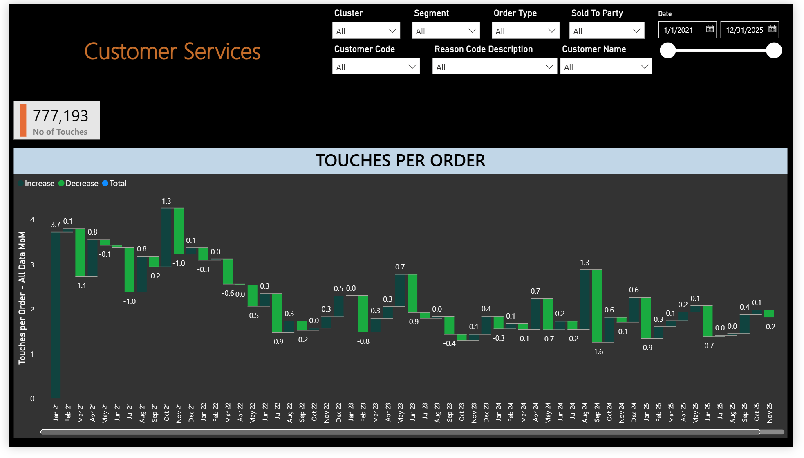

A waterfall of touches per order from January 2021 to November 2025. Each bar is the change from the previous month (increase or decrease). It shows the long term trend: touches per order start at 3.7 in January 2021 and settle below 2 in the later years, with seasonal spikes.

### 6. Orders automation

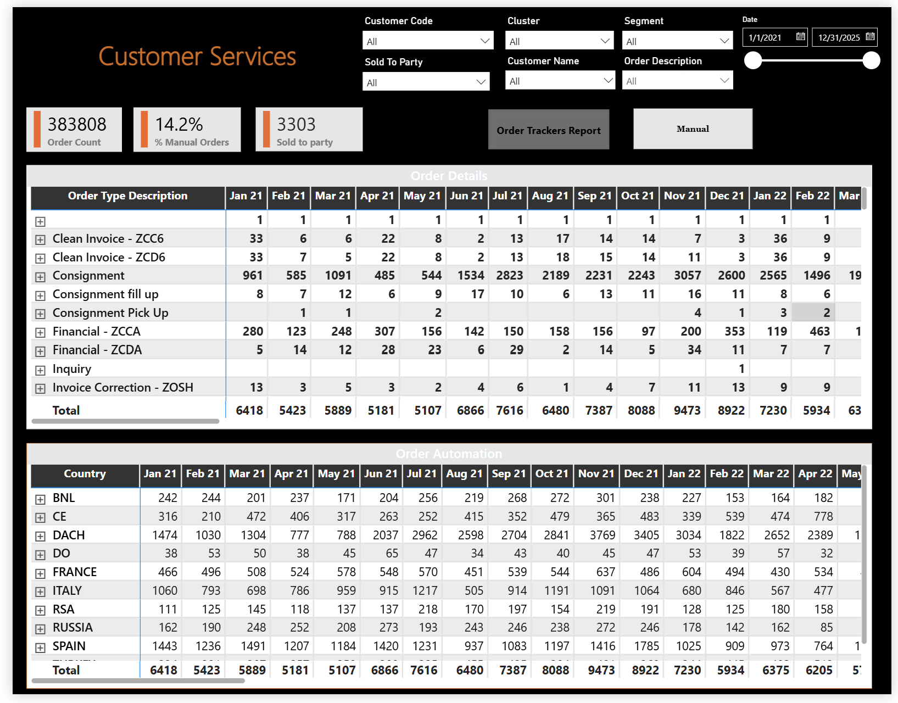

Order count, % manual orders and number of sold-to accounts, then two matrices by month: orders by order type (clean invoices, consignment, financial documents, invoice corrections and so on, with their SAP order type codes) and orders by cluster. Buttons jump to an order tracker report and to the manual orders view.

### 7. Automation glidepath

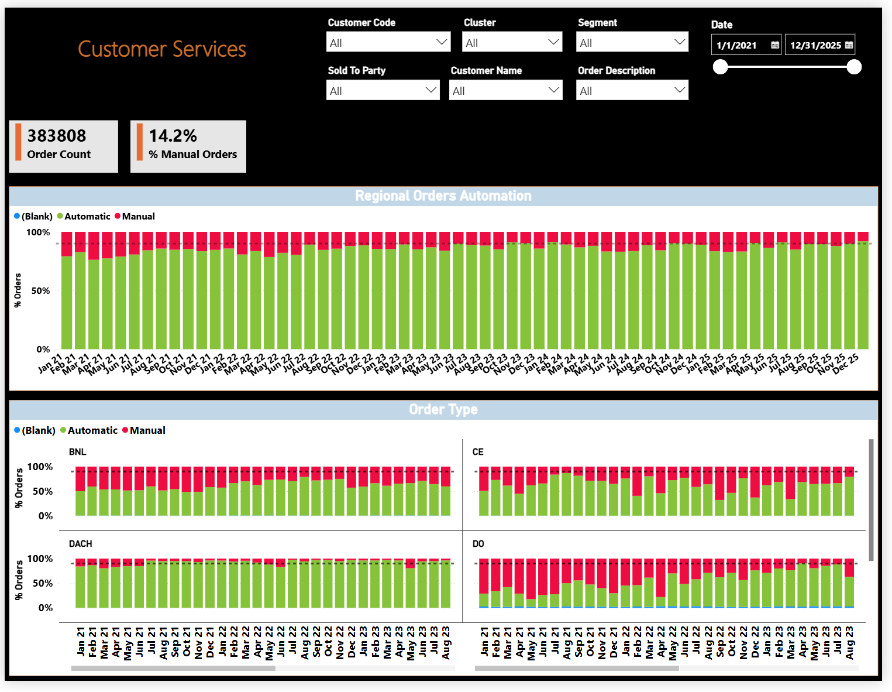

The share of automatic and manual orders per month from 2021 to 2025, with a dashed target line near 90% automatic. The bottom half repeats it per cluster, which makes it easy to see which cluster is behind the glidepath (in this view DO starts far below target and climbs over time).

### 8. Touchless orders

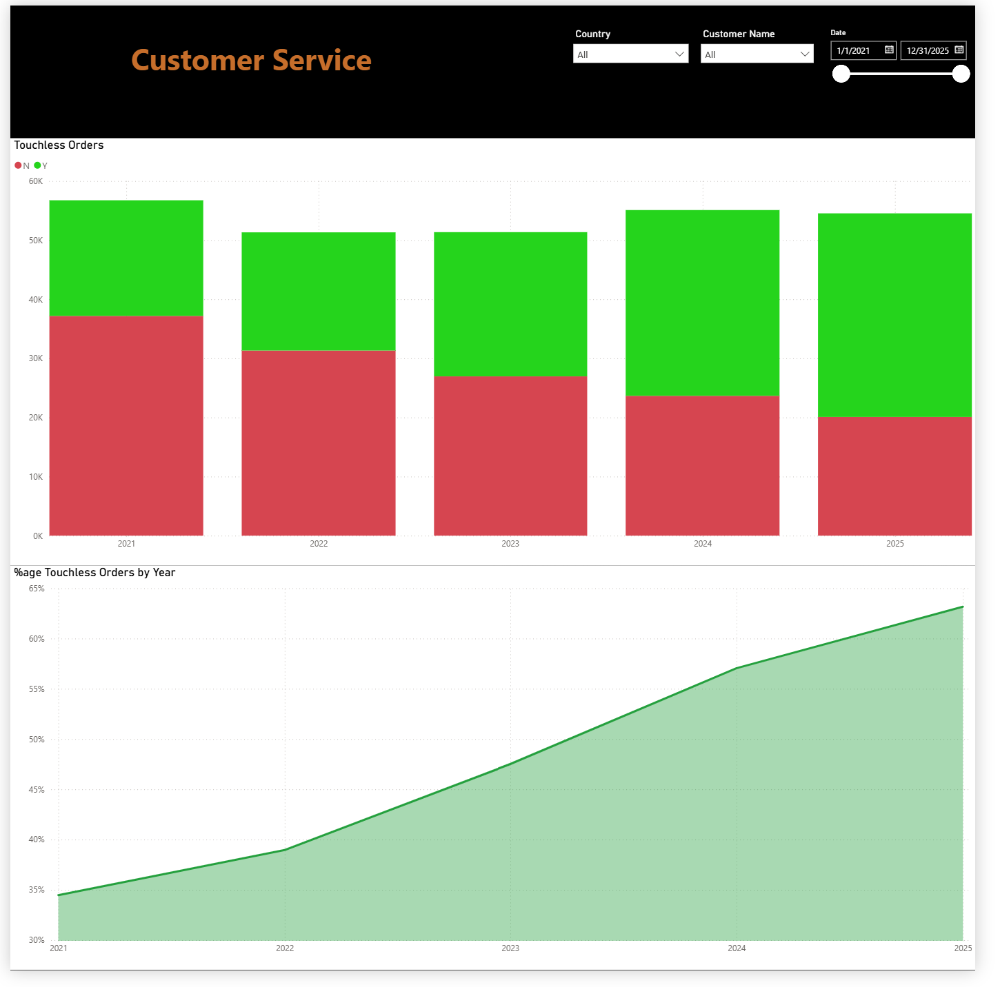

Orders with no touch at all (Y) against orders with at least one touch (N) per year, and the touchless share by year, which rises from about 34% in 2021 to about 63% in 2025.

### 9. Touches distribution

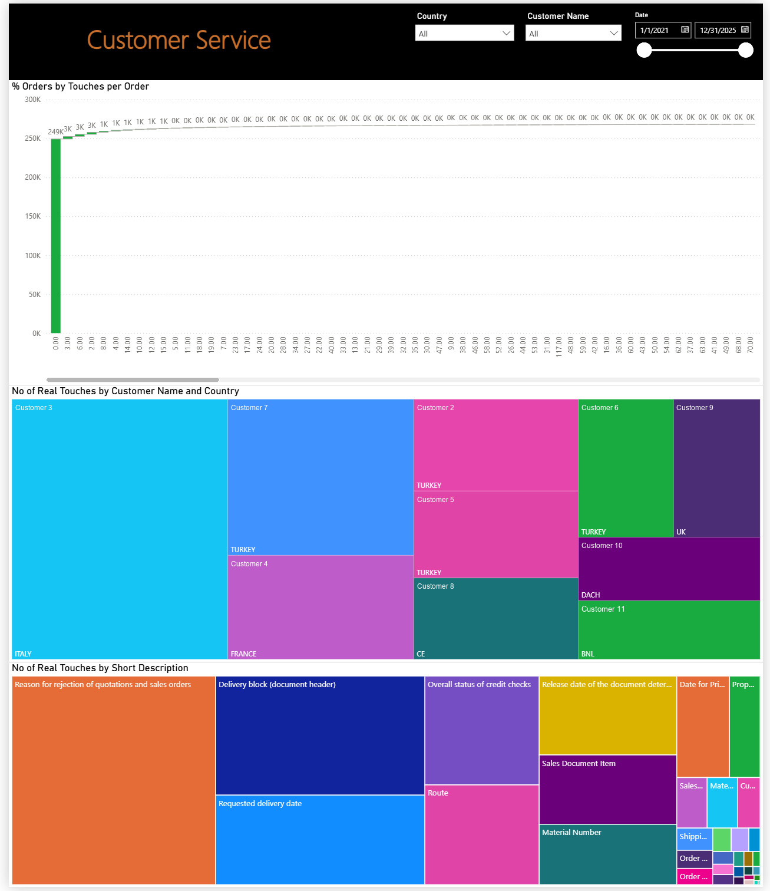

A histogram of orders by number of touches: most orders have none, and a long tail of orders is touched many times. Below it, real touches by customer and country, and real touches by reason, so the team can see which customers and which causes drive the tail.

### 10. Touches details

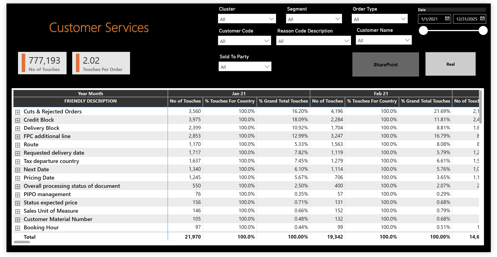

A matrix of touches by friendly reason description and month, with the number of touches, the share within the country and the share of the grand total. A SharePoint button opens the source folder, and the "Real" switch removes non real touches.

### 11. Order details

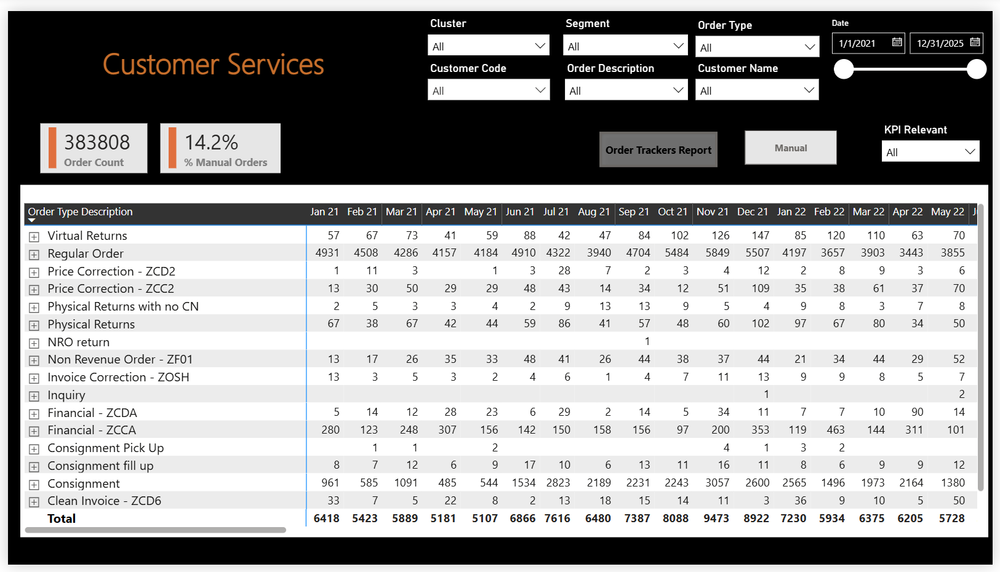

Order count by order type description and month (regular orders, returns, price corrections, non revenue orders and so on), with a KPI relevant filter that applies the same "calculation relevant" flag used in the KPIs.

### 12. Cluster view

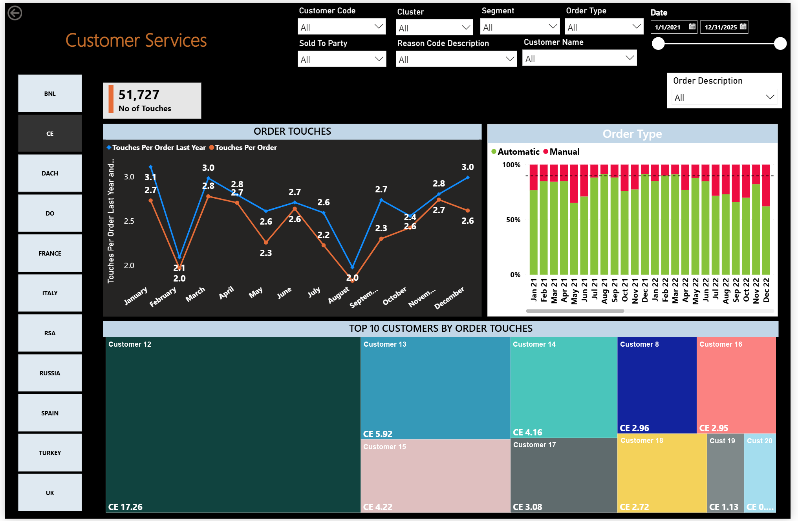

A drill page with one button per cluster on the left (CE selected here). For the chosen cluster: number of touches, touches per order against last year, automatic against manual orders by month with the target line, and the top 10 customers by touches.

### 13. The report in Power BI Desktop

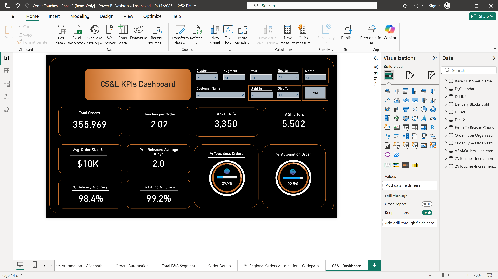

The report has 14 pages. The data pane on the right lists the model tables.

## Key measures

These are inferred from the visuals and the model:

- **No of touches:** count of rows in the touch log for the orders in scope.
- **No of real touches:** the same, keeping only changes flagged as real in the reason code mapping.
- **Order count:** distinct orders from VBAK, limited to calculation relevant order types.
- **Touches per order:** touches divided by order count.
- **% manual orders:** orders classified as manual divided by all orders. **% automated orders** is the opposite share.
- **% touchless orders:** orders with zero real touches divided by all orders.
- **Touches per order last year:** the same measure shifted by one year on the calendar table, used for every year over year line.
- **Month over month change:** this month's touches per order minus last month's, used in the waterfall.
- **Glidepath:** the target line on the automation charts, compared with the actual share each month.
- **% touches for country** and **% grand total touches:** each reason's share within its country and within the total.
- **Delivery accuracy, billing accuracy and pre-release average (days):** from the delivery dates and documents in LIKP.

